# Modbus Debugger

用于现场调试的 Modbus RTU / TCP 桌面工具。一个工作区可以同时运行主站和软件从站，用同一套点位搭建操作画布、编排积木脚本并调试实际读写。支持查看通信报文、导出当前采样，以及回放已有历史会话。

[下载已发布版本](https://github.com/loogg/modbus-debugger/releases) · [下载最新构建](https://github.com/loogg/modbus-debugger/actions/workflows/windows-release.yml) · [反馈问题](https://github.com/loogg/modbus-debugger/issues)

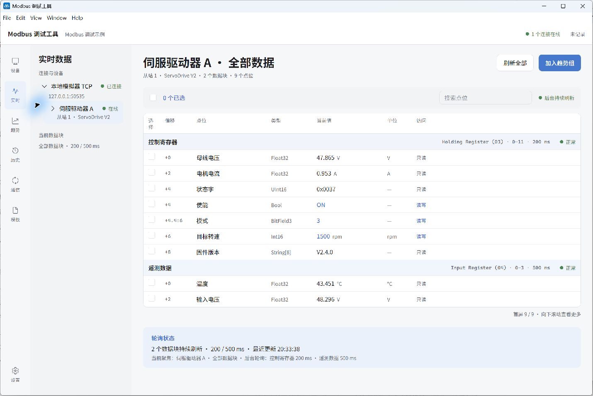

*截图使用本地 PyModbus 模拟器和示例工作区，采集版本见[截图来源](docs/images/README.md)。部分画面早于当前版本；功能与操作以当前文字说明和实际程序为准。*

当前提供 Windows x64 构建。直接使用软件不需要安装 Node.js 或 Python：

| 下载文件 | 使用方式 |
| --- | --- |
| `*-Portable.exe` | 单文件免安装，放到可写目录后运行 |
| `*.zip` | 解压后运行其中的 `modbus-debugger.exe`，保留同目录的其他文件 |
| `*-Setup.exe` | 运行安装向导，可选择安装目录；0.8.0 起使用 NSIS，卸载保留用户数据 |

最新分支构建位于 Actions 对应成功运行的 **Artifacts** 中，下载通常需要登录 GitHub，保留 14 天。版本标签发布的附件位于 Releases。

## 目录

- [一、从源码构建与运行](#一从源码构建与运行)
- [二、工具使用说明](#二工具使用说明)

## 一、从源码构建与运行

### 1. 准备环境

本文以 Windows x64 为例，使用 PowerShell 执行命令。

| 软件 | 用途 |
| --- | --- |
| Git | 获取源码 |
| Node.js 24.x（包含 npm） | 安装依赖、启动和打包；与 GitHub 构建环境一致 |
| Python 3.10+、PyModbus 3.15.0 | 可选，仅在使用本地模拟器或相关自动化测试时需要 |

### 2. 获取源码并启动

```powershell
git clone https://github.com/loogg/modbus-debugger.git
cd modbus-debugger
npm ci
npm start
```

`npm ci` 按锁文件安装依赖；首次安装需要联网下载依赖和 Electron。`npm start` 启动桌面窗口和开发服务器，修改前端代码时支持热更新。

### 3. 没有设备时，用模拟器体验

在一个终端中启动模拟器：

```powershell
python -m pip install -r tools/simulator/requirements.txt
npm run simulator -- --transport tcp --host 127.0.0.1 --port 50535 --units 1,2,3
```

保持该终端运行。模拟器提供 `127.0.0.1:50535` 上的 Unit 1、2、3，以及会变化的电压、电流、温度等数据。

也可通过虚拟串口对进行 RTU 联调。例如本机串口对为 COM1 ↔ COM2 时：

```powershell
npm run simulator -- --transport rtu --serial-port COM2 --baudrate 115200 --parity N --stopbits 1 --units 1,2,3
```

模拟器使用 COM2，上位机新建 RTU 连接使用 COM1，并设置为 115200 / 8N1。端口号只是示例，换机器时按实际配对修改；脚本不写死 COM 号，RTU 必须指定 `--serial-port`。下方示例工作区预设的是 TCP，RTU 联调需在软件中另建连接并绑定模板。

模拟器覆盖工具支持的 FC01/02/03/04/05/06/15/16/22，各 Unit 的数据独立。静态数据、只写地址和超时、异常、延迟、坏 CRC 等参数见[模拟器说明](tools/simulator/README.md)。

本仓库提供可以直接打开的[示例工作区](docs/examples/demo.workspace.json)，其中已配置连接、从站、模板和趋势组。先复制一份，避免自动保存修改仓库中的示例：

```powershell
New-Item -ItemType Directory -Force data/workspaces | Out-Null
Copy-Item docs/examples/demo.workspace.json data/workspaces/demo.workspace.json
npm start
```

在软件中进入 **设置 → 导入工作区**，选择刚复制的 `data/workspaces/demo.workspace.json`。连接成功后进入 **实时**，再在左侧点击 **伺服驱动器 A**，即可看到持续变化的值。

> 模拟器只用于学习、截图和验证。连接真实设备时，请使用设备手册中的通信参数、Unit ID 和寄存器定义。

### 4. 打包为可分发的软件

```powershell
npm run make -- --platform=win32 --arch=x64
```

该命令已经包含程序构建，无需先执行 `npm run package`。完成后，`release/` 根目录直接包含：

```text
release/
├── modbus-debugger-<version>-win-x64/
├── modbus-debugger-<version>-win-x64.zip
├── modbus-debugger-<version>-win-x64-Portable.exe
└── modbus-debugger-<version>-win-x64-Setup.exe
```

版本号来自 `package.json`。新产物全部生成成功后才替换和清理旧版本；旧目录中的非程序文件会保留到 `release/data/backups/`。

只需要目录版进行本地验证时，可使用 `npm run package`，输出在 `out/`。测试、构建实现、目录结构和 GitHub 工作流见[开发说明](docs/development.md)。

## 二、工具使用说明

建议按下面的顺序开始：

**建立连接 → 扫描/临时读取 → 配置模板并绑定从站 → 实时读写 → 趋势与记录 → 历史回放**。

### 1. 建立 RTU 或 TCP 连接

1. 进入 **设备**，点击左侧 **添加连接**。
2. 输入名称，选择工作角色（主站 / Client 或从站 / Server）、RTU 或 TCP，并填写通信参数。已有工作区默认保持主站角色。
3. 创建后，在设备树中选择连接。主站通过 **连接 / 断开连接** 管理链路；从站通过 **启动从站 / 停止从站** 管理响应。修改参数前先停止对应链路，保存后再启动。

| 类型 | 需要与设备一致的参数 |
| --- | --- |
| RTU | 串口、波特率、数据位、校验、停止位；串口下拉支持枚举，也可手工输入 |
| TCP | 设备/网关 IP 地址、端口；本地示例为 `127.0.0.1:50535` |

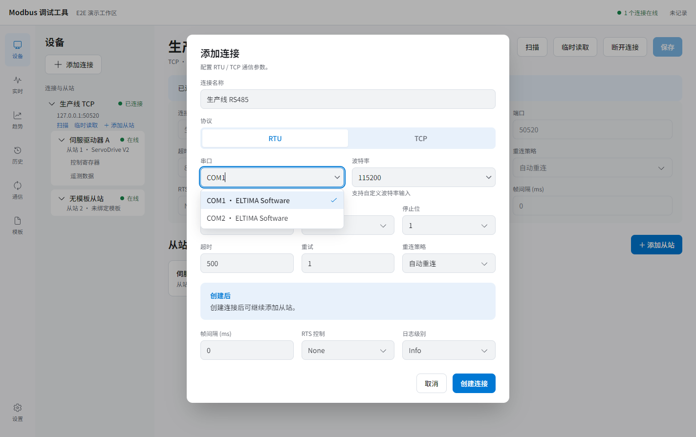

连接参数提供独立的 **连接超时** 和 **应答超时**。连接超时控制 TCP 建连或打开串口，缺省 3000 ms。自动重连按配置的 **重连间隔** 固定等待，缺省 1000 ms，支持 0 ms 尽快尝试。应答超时控制单次 Modbus 请求的响应等待。选择手动策略后，连接通过操作按钮启动。

**主站“已连接”不等于设备已响应。** RTU 已连接表示串口已打开，TCP 已连接表示 Socket 已建立；具体从站和地址是否可用，还需要扫描或读取确认。

**作为本机从站使用：**

1. 添加连接时选择 **从站 / Server**。TCP 填写本机监听地址和端口（例如 `127.0.0.1:15020`）；连接外部设备时可改为本机网卡地址或 `0.0.0.0`。RTU 填写应用占用的串口及与外部主站一致的通信参数。
2. 在连接下 **添加从站**，设置 Unit ID 并绑定模板；也可点 **新建四区模板**，建立各 16 项、从地址 0 开始的 Coil、Discrete Input、Holding Register、Input Register，随后在模板库修改范围和点位。不同 Unit 的值相互独立。
3. 在连接页点击 **启动从站**，TCP 显示“监听中”与连接的主站数量，RTU 显示从站运行状态。外部主站可使用 FC01/02/03/04/05/06/15/16/22 访问模板定义的地址，可读范围按点位权限确定，未定义地址返回异常 02。
4. 选择设备后点 **编辑从站内存**，切换数据区并设定数值，支持十进制和 `0x` 十六进制。四类数据区均可本地设置；外部主站只能写 Coil / Holding Register。当前值在提交成功后更新，未提交输入不会改变设备内存。
5. **保存为启动初始值** 将该 Unit 当前全部数据区保存到工作区；停止/启动保留内存，应用重启加载保存的初始值。外部写入不会自动覆盖启动值。实时、趋势和记录共用此内存，从站模式不会轮询；通信页显示 RX 请求与 TX 响应。

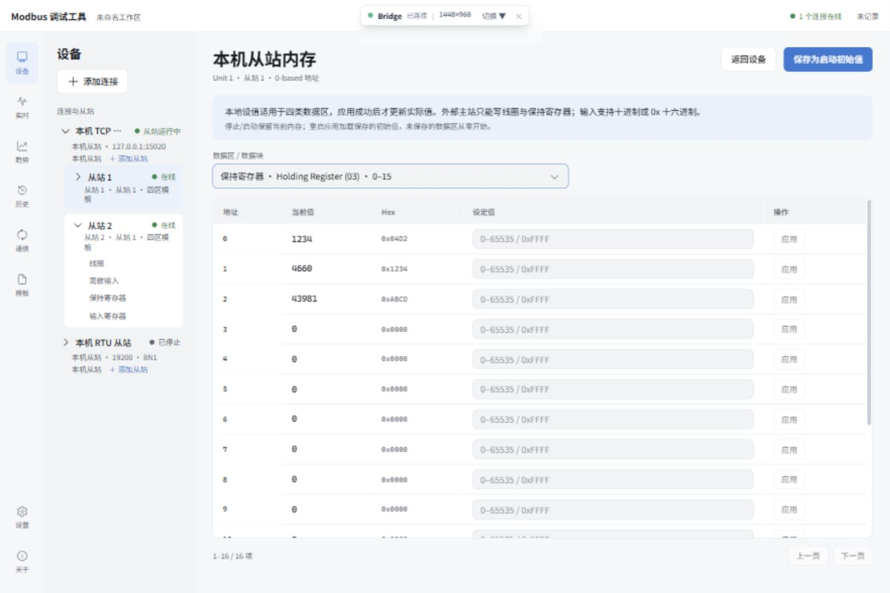

例如 COM1 ↔ COM2 虚拟串口对：应用从站使用 COM1，独立主站使用 COM2，双方设置 19200 / 8N1。RTU 广播 Unit 0 写入会更新所有启用且具有该范围的 Unit，并且不发送响应。

### 2. 扫描从站

在连接下点击 **扫描**，填写起始和结束 Unit，点击 **开始扫描**。

- 范围为 1–247，按 Unit ID 顺序探测。
- **高级扫描配置**默认折叠，可设置读取功能码、起始地址、超时和重试。
- 默认使用 FC03，从地址 0 读取 1 个寄存器，单次超时 150 ms，重试沿用连接设置。
- 功能码可选 FC01/02/03/04；读取数量固定为 1（位或寄存器）。
- 扫描期间当前连接的周期轮询暂停；点击 **停止扫描**后，当前请求收尾，不再探测后续地址，并恢复轮询。

进度中的“已检查 4/247、当前 Unit 5”表示前四个从站地址已检查完，**不是发现了四台设备**。发现数量单独显示，结果会陆续加入表格。正常响应和合法异常响应都算发现从站；可再用临时读取核对实际数据。

停止扫描会保留本次结果；重新开始会清空上次扫描结果。扫描不会自动把设备加入左侧列表，需要点击结果中的 **添加从站** 或使用左侧 **＋ 添加从站**。已添加的从站不受重新扫描影响。

### 3. 临时读取与失败排查

在连接下点击 **临时读取**，填写地址区、起始地址、数量和 Unit ID，确认请求预览后点击 **读取**。默认读取 FC03、地址 0、10 个寄存器。

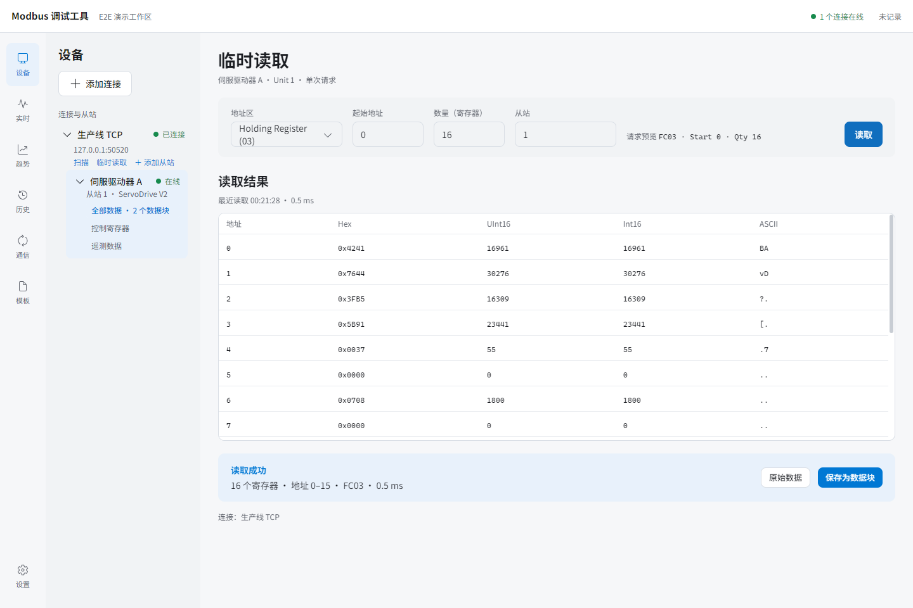

临时读取是手工请求，不会自动建立周期轮询。读取成功后可以查看原始数值，并点击 **保存为数据块**，选择已有模板或新建模板继续配置。

失败时页面会显示原因、请求参数及可用的 Trace ID，点击 **查看通信诊断**可进一步核对报文：

| 提示 | 建议检查 |
| --- | --- |
| 超时 | Unit ID、串口参数/IP/端口、接线、设备是否支持本次功能码和地址；超时只表示未收到有效匹配的响应 |
| 异常 `0x01` | 设备是否支持该读取功能码 |
| 异常 `0x02` | 起始地址和读取范围是否存在，是否误用了 PLC 编号 |
| 异常 `0x03` | 请求参数是否符合设备要求 |
| 连接或传输失败 | 串口是否被占用/拔出、网络是否断开 |
| CRC、格式或响应不匹配 | 在通信诊断中检查原始帧、Unit ID、功能码及通信参数 |

读取期间会锁定输入和按钮。当前连接正在扫描时，请先停止扫描再临时读取；失败后不会把上次成功的数据当作本次结果展示。

### 4. 配置模板、数据块和点位

工具将通信连接与设备寄存器定义分开管理：

| 对象 | 表达的内容 |
| --- | --- |
| 连接 | 一条串口或 TCP 链路 |
| 从站 | 连接下的 Unit ID，以及绑定哪个设备模板 |
| 设备模板 | 可被多个从站复用的寄存器定义 |
| 数据块 | 地址区、起始地址、长度、轮询周期 |
| 点位 | 如何把数据块中的寄存器/位解释为电压、状态、转速等值 |

1. 进入 **模板**，左侧按“设备模板 → 数据块”展开。点击模板名称，右侧可以修改名称、添加或删除数据块；点击子节点进入对应数据块。
2. 添加数据块，设置地址区、起始地址、长度和周期。同一模板、同一地址区的数据块不能重叠。块页面顶部的返回入口可以回到模板概览。
3. 添加点位，设置偏移、数据类型、寄存器数量、字节/字序、位宽、缩放和访问权限等。
4. 回到 **设备**添加或编辑从站，填写 Unit ID 并绑定模板。

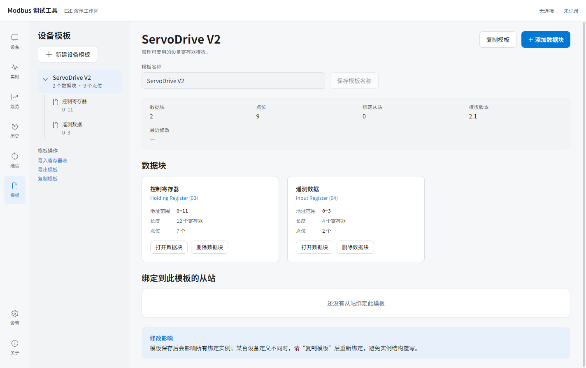

点位允许共享寄存器，例如用一个完整状态字和多个 Bool/BitField 解释同一寄存器。模板修改会影响所有绑定的从站；设备定义不同时，应先复制模板再修改。

**内存布局**显示点位占用定义，即使没有连接设备也能看到 Float32 的两个寄存器、字节/位映射和重叠点位；超过 32 个地址可以翻页。点击布局中的点位可回到映射详情。

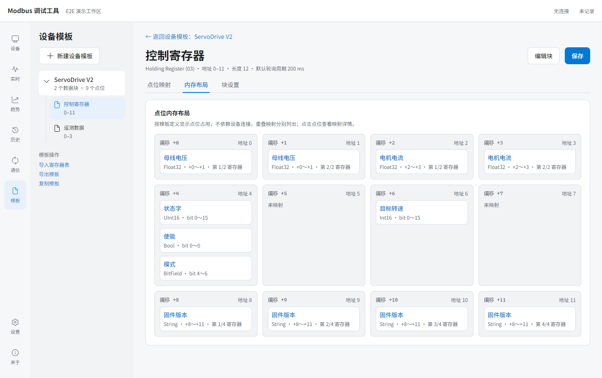

数据块页面的 **保存**直接保存当前定义，不弹出工作区文件框；未命名工作区会保存在默认数据目录的 `data/workspaces/`，已有工作区沿用原路径。删除数据块需要确认，会同时移除块内点位和相关趋势引用，历史记录保留。需要自选工作区文件位置时，使用设置页的另存为。

**核心地址统一为 0-based。** 例如 Holding Register 起始地址 0 表示 FC03 的协议地址 0，不能直接填 40001。PLC 风格地址只在导入寄存器表时转换。XLSX、CSV、JSON 或剪贴板导入应先完成字段映射与预览，再应用到模板。

### 5. 实时查看与写入

进入 **实时** 后，在左侧选择从站查看全部点位，或选择某个数据块聚焦查看。主界面预览中的表格会显示偏移、类型、当前值、单位及访问权限。

- 每个数据块按自己的周期刷新，切换页面不会停止后台轮询。
- 双击可写点位的当前值进入编辑，按 **Enter** 提交、**Esc** 取消。
- 匹配的正常写应答表示写入成功，设备当前值由正常采集更新。输入与待写值单独显示。
- 点位访问权限支持只读、读写、只写。只写点位显示“上次写入”，写命令记录保留在当前运行内存中。
- 写超时和传输错误显示“结果未知”，可查看设备状态及通信记录。设备异常应答显示拒绝。
- 读写寄存器的部分位/字节先读取最新寄存器再合并，只写部分字段使用 FC22（0x16）掩码写，需设备支持。混合数据块的轮询跳过只写地址，可读别名继续采集。
- 输入寄存器和离散输入只读；保持寄存器、线圈还要看点位的访问权限。

较窄窗口会在表格内横向滚动，不会隐藏关键工程列。点位配置了高风险写入确认时，提交前还会出现确认提示。

### 6. 观察趋势与导出采样

1. 进入 **趋势**创建趋势组并添加信号，也可在实时表选择点位后点击 **加入趋势组**。首次加入时可设置每个点位的缓存容量。
2. 在 **信号**页点击容量数字查看缓存数量、时间范围和引用关系。在 **图表**页观察曲线和状态变化，各页面可单独选择刷新周期。
3. 点击 **导出采样数据**保存组内点位，也可逐个导出。选择当前保留的全部样本，或指定 UTC 毫秒时间范围，再选择 CSV 文件位置。

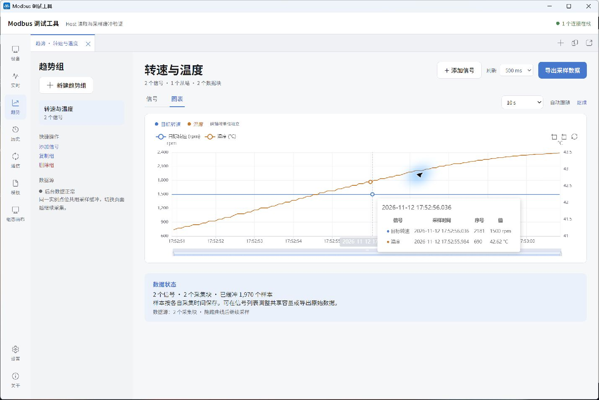

数值信号用折线，Bool 用数字波形，Enum 用状态段，String 用变化事件。采样缓冲由后台维护，隐藏曲线和切换页面后继续收集成功采集的样本。同一个设备点位被多个趋势组和画布曲线引用时，共用一份缓冲。

共享容量默认 10,000 点，可设置 10–100,000 点，后台同时启用的总容量上限为 2,000,000 点。容量可在趋势信号、画布曲线属性或设备实例的“采样缓冲”中修改，所有引用同步。容量满后覆盖最旧样本，修改容量前可查看实际保留的起止时间。

允许将不同采集块的信号放在同一图中。光标吸附可见信号最近的真实时间，各条曲线分别标记最近样本，提示框逐条列出实际采样时间、序号和值。绘图控制显示点数并保留极值，CSV 导出使用缓冲中的原始精度数据。

**分轴依据是单位，不是信号个数。** 请在点位配置中一致填写单位，例如 `V`、`A`、`rpm`：

| 数值信号的单位种类 | 图表显示 |
| --- | --- |
| 1 种 | 多个信号共用一条纵轴 |
| 2 种 | 同一图表使用左右两条纵轴，同单位信号共用刻度 |
| 超过 2 种 | 按单位拆成多个图表，可上下滚动查看；每组保留该单位的全部信号 |

例如 12 个数值信号分属 4 种单位，会显示 4 个图表；未填写单位的数值信号归为同一组。Bool、Enum、String 显示在状态轨道中，不占用数值纵轴。

可选择最近 30 秒、60 秒或 5 分钟。**暂停**冻结当前显示，**继续**在自动跟随开启时恢复追踪最新数据。后台采样在暂停期间继续，导出对话框会显示当前缓冲可用范围。

String 轨道显示初始状态及后续变化。0.9.1 起，相同初始值与首条记录不会重复叠字；事件密集时会避让文字，长内容用省略号表示，悬停事件点可查看完整值。


缓冲保存在内存中，退出程序后释放。需要保存的数据请在被覆盖前导出。数据块支持 0 ms 尽快采集和 1 / 2 / 5 / 10 ms 等周期，实际节奏由通信耗时与调度决定，界面刷新独立配置。连接参数中可设置读取重试间隔，0 ms 表示尽快重试，请求间隔位于高级连接参数。

### 7. 历史回放与通信诊断

**历史：**进入 **历史**，在左侧选择记录会话，查看趋势、数据及信号定义；点击 **回放**可离线查看变化过程。历史会话保留记录时的点位定义，后续修改模板不会改变旧会话的解释。

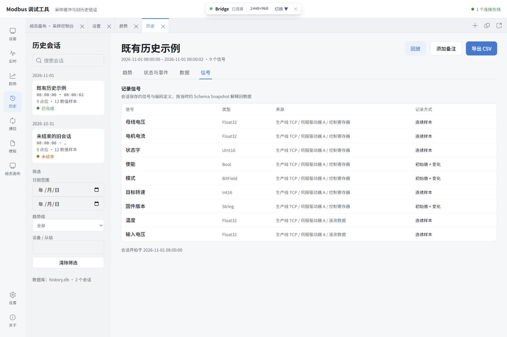

可按日期范围、趋势组和从站名称筛选左侧会话列表，点击 **清除筛选**恢复显示。**添加备注**可保存会话备注，保存后在状态与事件中查看。当前 **导出 CSV** 会把 CSV 文本复制到剪贴板，可粘贴到表格或文本文件中保存。

**通信：**进入 **通信**并选择连接，查看请求/响应事务，点击一行展开详细信息和原始报文。通过 **连接健康**查看请求率、耗时和错误统计；通过点位追踪检查事务来源。

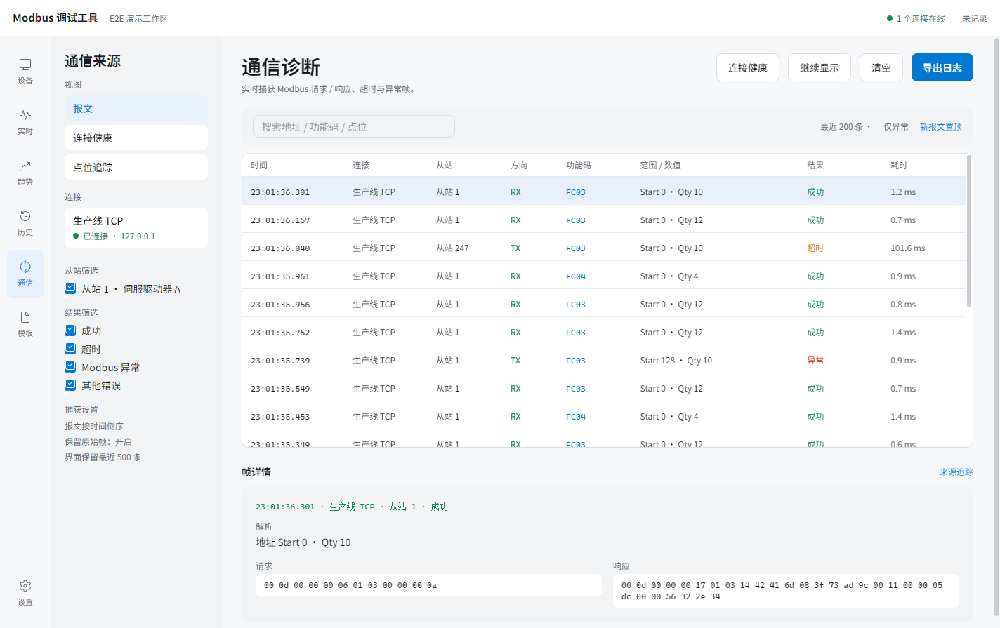

侧栏 **结果筛选**可组合勾选：

| 筛选项 | 对应的事务结果 |
| --- | --- |
| 成功 | 收到有效的正常响应 |
| 超时 | 未在超时范围内收到有效匹配响应 |
| Modbus 异常 | 设备返回合法异常响应，例如 `0x02` 非法地址 |
| 其他错误（0.9.1 起） | CRC、格式、传输错误或意外响应等其他事务结果 |

结果筛选可与从站筛选、搜索组合使用；全部取消勾选时事务列表为空。**仅异常**会进一步排除成功事务，仍受侧栏筛选限制。下方的帧解析错误记录单独展示，不受事务结果筛选控制。

点击 **暂停**固定当前事务列表，**继续显示**恢复更新；设备通信仍会继续。**清空**清除内存诊断记录，**导出日志**将当前筛选的事务文本复制到剪贴板。

### 8. 保存工作区和管理文件

设置页提供工作区文件操作、采样缓冲说明、既有历史库位置和显示偏好。

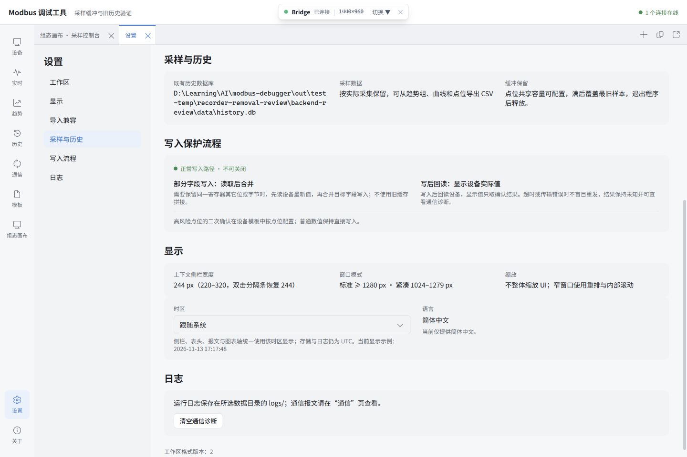

在 **设置 → 另存为** 保存 `.workspace.json`；确定文件位置后，配置修改会自动保存。**导入工作区**用于打开已有文件，**导出工作区**将 JSON 文本复制到剪贴板。

在 **设置 → 显示 → 时区**中选择跟随系统、UTC 或指定地区。绝对时间会按所选时区显示，例如同一报文的 UTC 时间为 08:00:00 时，在上海显示为 16:00:00；存储的 UTC 时间戳不变。历史回放轴和状态轨道上的 `00:00:00` 表示从会话开始计算的相对时长，不随时区改变。

默认存储根目录是程序所在目录；Portable 使用外层 EXE 所在目录，源码开发模式使用项目目录：

```text
程序目录/
├── data/
│   ├── prefs.json        # 窗口、语言、时区等偏好
│   ├── history.db        # 历史数据库
│   └── workspaces/       # 保存对话框的默认位置
├── cache/                # 浏览器缓存
├── logs/main.log         # 运行日志
└── temp/                 # 临时文件与 Portable 解压目录
```

也可指定另一处可写目录：

```powershell
.\modbus-debugger.exe --data-dir="D:\ModbusData"
```

或设置 `MODBUS_DATA_DIR` 环境变量，命令行参数优先。目录不可写时会提示并退出，不会悄悄改写到 AppData。程序或所选目录在 C 盘时，相关文件自然仍在 C 盘；Windows 安装器的注册表、快捷方式等系统机制不受这一约定限制。

0.8.0 起使用新的目录布局，不自动覆盖或删除旧 AppData 文件。需要的旧工作区可手动打开；设置页可查看当前历史数据库路径。

### 9. 关于与检查更新

0.10.0 起，左侧底部的 **关于** 显示当前软件版本、架构和运行形式：

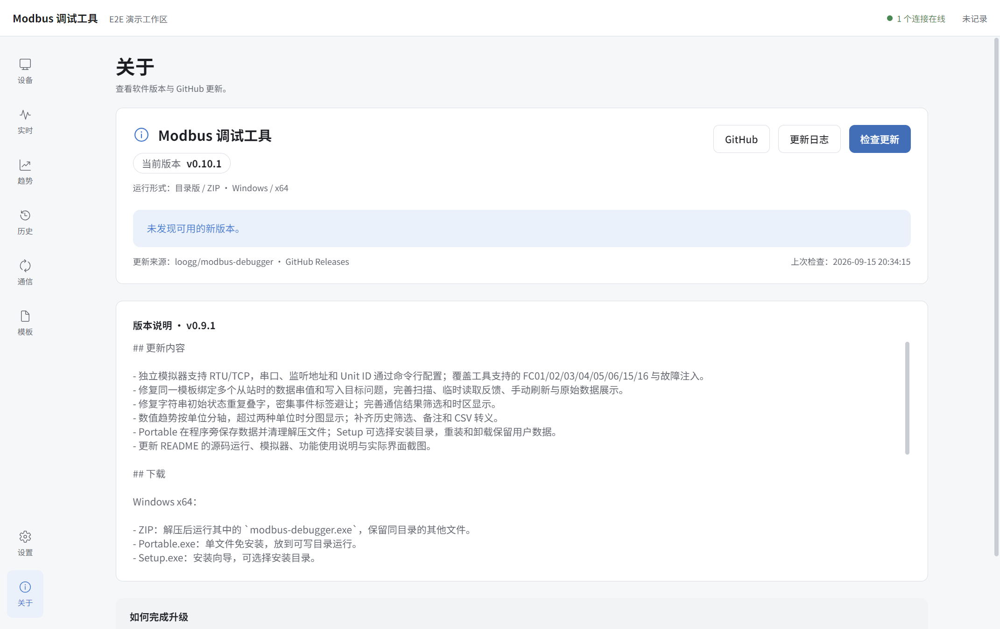

1. 点击 **检查更新**，获取本项目 GitHub Releases 的最新正式版本，不会使用 Actions 构建或自动降级。
2. 发现新版本后，可阅读版本说明，点击 **下载 v…**。安装版下载 Setup、Portable 下载 Portable、目录版/ZIP 下载 ZIP，均匹配当前架构。
3. 下载进度实时显示，可取消；切换页面不会中断下载。网络失败、GitHub 限流、缺少匹配附件或校验失败会显示原因，可重新检查或下载。
4. 提示 SHA-256 校验通过后，点击 **安装更新并重启**并确认。软件保存工作区、停止通信并关闭历史库，然后自动安装并重新启动。目录/ZIP 自动解压，Portable 自动替换外层 EXE，Setup 沿用原安装目录，无需手动解压。

升级保留用户文件；新版本未确认正常启动时自动恢复旧程序。完整更新包保存在当前数据根目录的 `data/updates/`，程序备份在 `data/updates/backups/`，准备文件在 `temp/self-update/`。下载、安装都由用户主动触发。开发模式请通过源码更新。

0.10.1 起支持自升级。更早版本需要先从[GitHub Releases](https://github.com/loogg/modbus-debugger/releases)手动获取带自升级能力的版本；Release 中的 `*-manifest.json` 是更新用的文件清单，无需手动打开。

### 10. 多窗口工作台

左侧模块导航会激活已有页面。上方“新建页面”可以打开新的功能页，“打开当前页面副本”用于并排查看不同设备或趋势；也可 Ctrl+单击主要模块导航。

- 各页面独立选择设备、筛选、滚动和编辑；同一趋势组的不同视图也可选择不同时间窗口。
- “弹出当前页面”把当前页移到独立系统窗口；“回入主窗口”或独立窗口的 X 将它收回，草稿和页面状态保留。
- 标签上的 X 才会关闭页面；存在未提交的编辑时可以取消关闭。关闭主窗口会退出应用并结束全部独立窗口。
- 标签与对象选择随工作区保存。重启后恢复到主窗口；再次弹出会使用本机记住的位置。临时输入草稿不跨应用重启保存。

### 11. 自由组态画布

在“组态画布”中点击“新建画布”，从左侧图标控件库拖入控件，或单击图标添加。支持文字标签、数值显示、指示灯、按钮、开关、数值输入、仪表、趋势图和容器。基础控件默认紧凑、透明，名称标签、边框、背景可按需打开。“适合内容”可收紧已有控件尺寸。编辑模式的工具栏提供“背景”色板和自定义颜色，背景随画布保存，支持撤销。

1. 编辑模式中选择控件，在右侧配置名称、位置、大小、颜色与绑定点位。可从不同设备中选择已有点位，不需要重复建立连接。
2. 框选或 Shift+单击可多选，一起拖动、对齐、复制或调整层次。方向键微调，Shift+方向键移动 8 px；Ctrl+Z/Ctrl+Y 撤销/重做，Ctrl+C/Ctrl+V 复制粘贴控件。
3. 点击“保存画布”，再切换“运行”。编辑模式锁定设备写入；运行时数值输入需点击“写入”，按钮发送配置值，开关控制 Bool 点位。
4. 可读点位显示设备采集确认值。只写输入显示“上次写入”，只写开关带“命令”标记，并按最近成功命令显示 ON/OFF。正常应答、拒绝和未知结果有状态反馈，高风险点位沿用写入确认。
5. 同一画布可打开多个视图；保存布局后其他视图同步。若两个页面同时编辑，过期保存会被拒绝并保留草稿，可取消或重新载入最新版本。

选中数据或控制类控件，右侧“状态预览”可从“跟随设备”切换到“模拟预览”。可输入模拟值、选择指示灯的亮灭/各条规则/默认状态、查看仪表最小/中间/最大值，并检查输入与按钮的正常、禁用、写入中、失败外观。曲线生成独立的示例波形。预览只影响当前编辑视图，控件带“预览”标记，不写设备或历史记录。可单独恢复跟随或“清除预览”；进入运行或切换画布清除预览，弹出/回入保留。预览数据不随工作区保存或导出。

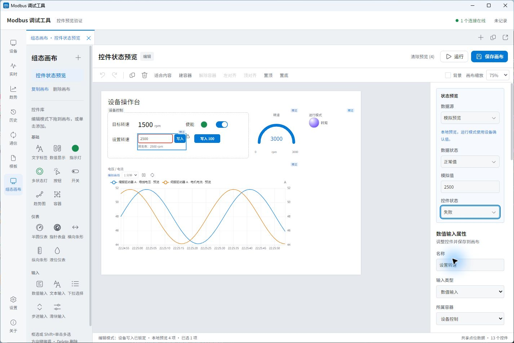

容器可包含控件或其他容器，拖动容器时整体移动。先选容器再添加控件，或从控件库直接拖入容器；已有控件用“所属容器”加入或移出。多选后“建容器”（Ctrl+G）可分组，“解除容器”（Ctrl+Shift+G）保留控件在画布中的位置。容器复制、删除包含全部子控件。

仪表提供半圆仪表、指针表盘、横向条形、纵向条形和液位仪表，可从图标库直接添加，在属性中切换样式。量程、单位和显示精度沿用绑定点位与仪表配置。

指示灯提供亮/灭和多状态两种模式。亮灯、灭灯可分别设置文字、颜色，填充可选纯色、线性或径向渐变。多状态灯可读取变量枚举，也可手动添加等值/区间规则、设置边界包含关系，并用上下箭头调整匹配顺序。第一条匹配的规则生效，未匹配值使用可配置的默认文字、颜色和渐变。枚举按原始值判断，普通数值按工程值判断。离线保留最后确认状态并显示通信质量，未采集或无效数值显示默认状态及相应提示。

颜色可通过色板或 HEX 输入，状态表随画布保存、复制及工作区导出/导入。编辑后先保存画布，再导出工作区。

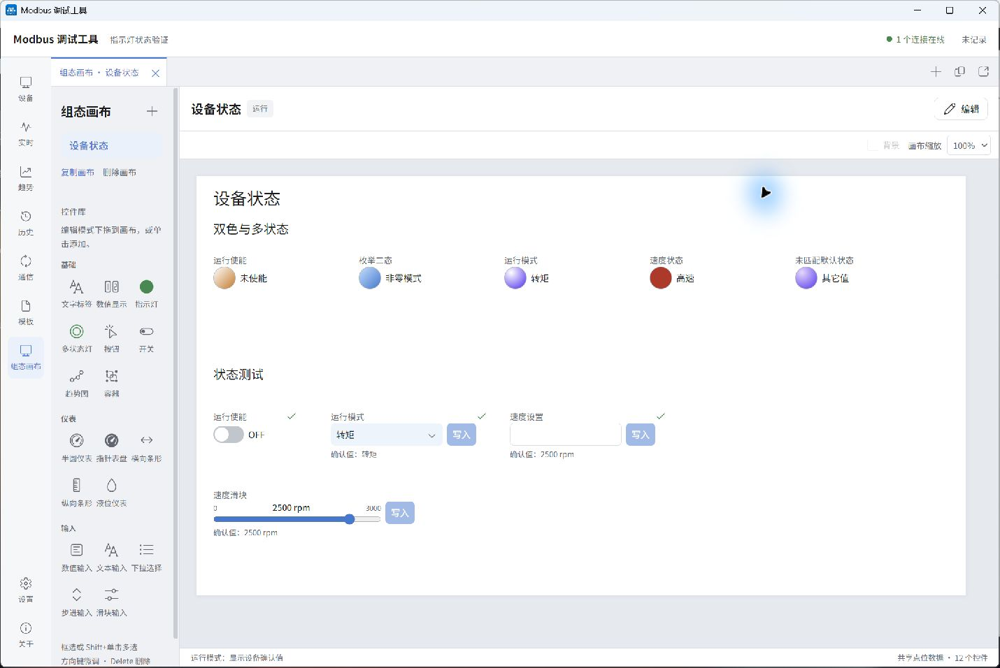

输入提供数值、文本、下拉选择、步进和滑块。文本输入绑定可写 String 点位，清空后写入可清除设备字符串。下拉选项来自变量的枚举映射，Bool 默认提供 OFF/ON。步进可设置步长及可选范围，滑块设置上下限和步长。选项、加减和滑动先形成待写值，点击“写入”才提交。下拉弹层与控件边缘对齐，支持画布缩放、键盘及原生独立窗口。改变输入类型或绑定时清除原目标的运行草稿。

选中控件后，右侧“样式”可分别设置文字颜色、字号、字重、对齐、边框颜色/粗细及圆角。输入和按钮还可选择描边、柔和填充、实色、下划线外观。内边距会同步调整控件外框，样式随画布保存和复制，也支持一键恢复默认样式。

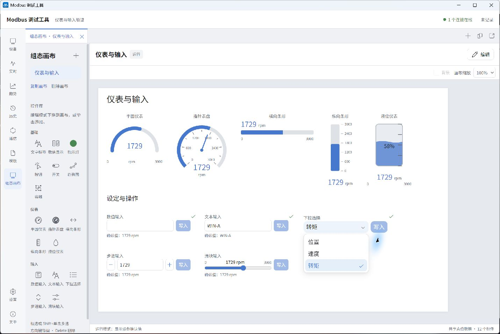

曲线使用 Apache ECharts（Apache-2.0，可商用），每个曲线控件最多添加 16 个数值信号，可配置颜色、点击图例显隐、十字游标读数、滚轮/框选缩放及拖动时间范围。不同单位使用独立坐标轴，超过两种单位分图显示；暂停保留当时采样，点击“恢复跟随”返回最新数据。组件许可随程序保存在 `resources/licenses/`。

加入画布曲线信号时可设置共享容量，已有缓冲默认带入当前容量。运行时点击曲线工具栏的导出按钮可保存其原始样本。各画布页面有独立的刷新周期，多个页面读取同一点位时复用前端缓存。

画布内容与绑定保存在工作区中，可随工作区导入、导出。画布缩放仅影响画布内容；窗口较小时可滚动查看，不会缩小整个应用。

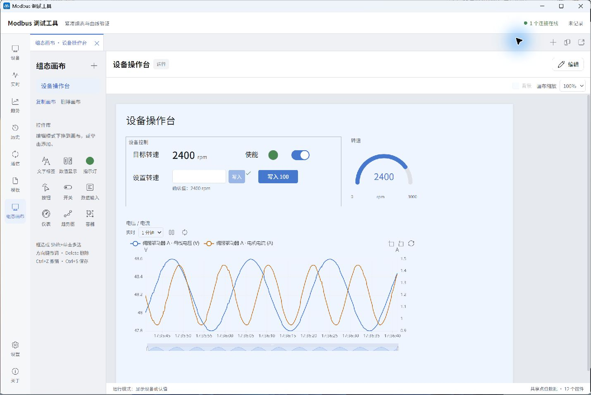

### 12. 主站积木脚本

要连起主站、软件从站、操作画布和自动流程，可以打开[泵站打压示例](docs/examples/pressure-bench.workspace.json)。[运行方法与验收记录](docs/acceptance/pressure-bench.md)包含正常升压、单站掉线和整条链路中断的实测结果。

从左侧进入「主站脚本」，新建流程并把步骤接到「开始」下。「读取到变量」立即保存所选点位最新的有效确认值，变量在本次运行内有效。固定值比较、范围判断和「与变量比较」也使用当前确认值。需要写后反馈时，按「写入点位 → 等待新采样（反馈点位）→ 读取到变量或判断」连接积木。「等待条件」可组合从站状态、点位条件和「与」「或」「非」，条件成立后继续。运行期间可点击「停止」。步骤结果显示写应答、实际读取值和失败原因，点击结果可定位积木。

「Lua 预览」可查看并复制生成的文本。「导出」保存流程 JSON，在另一工作区可通过「导入脚本」载入，然后按需重新绑定设备和点位。

「流程」分类里的「记录日志」可以只填文字，也可以在「附加值」接入运行变量或点位值。执行时在底部留下带毫秒时间的记录，点击即可定位积木。例如「反馈转速」接「目标转速」会记录当时的确认值。如需写后的新读数，在前面接「等待新采样」。

右键可执行积木选「设置断点」，或选中积木后点检查栏里的同名按钮。红点表示断点，蓝箭头指向定位的步骤。「运行」遇到断点会停在执行前，「调试」从第一步开始暂停。「单步」执行眼前的积木后停在下一个实际步骤，「继续」运行到下一个断点或结束。手动暂停会让进行中的通信或等待先结算。暂停时可以查看运行变量，写入积木还会显示本次待写值。主站在此期间照常采样。

积木托盘默认展开，选择分类后可连续拖出积木。分类栏底部可收起或恢复托盘。写入和比较的值槽可填写常量，也可从「取值」拖入运行变量或点位确认值。例如先把目标转速保存为「写前转速」，再将该变量接到写入积木即可恢复设定。新条件槽显示处于「假」的拨钮，点击或按空格可切换真／假，也可以拖入设备条件。「如果」的「分支」菜单可增加「否则如果」和「否则」。点击运行过的条件可查看判定值、判断时间和相关点位的采样时间。右键点位积木或实时点位名称，可以查找读写该点位的脚本。

「主循环」每轮让出调度。「重复直到」在每轮开始时判断条件，成立后离开循环。「延时」决定轮次间隔，「等待新采样」决定采样时机。「跳出循环」继续当前循环之后的步骤，「停止流程」结束整次运行。「尝试执行」中的操作失败时跳过执行区剩余步骤，运行「出错时」中的处理，再继续容器下方的步骤。空处理区将错误交给外层。高风险动态写入在发送前显示并确认本次实际值。

### 13. 常见问题

| 问题 | 处理方式 |
| --- | --- |
| 已连接，但没有从站数据 | 先用扫描或临时读取验证 Unit ID；再确认从站已启用并绑定包含数据块/点位的模板 |
| 进入实时页面后是空的 | 在左侧选择从站或数据块 |
| 读到数值但明显不对 | 核对数据类型、字节/字序、偏移、寄存器数量及缩放参数 |
| 修改模板影响了另一台设备 | 两个从站可能绑定了同一模板；设备定义不同请复制模板 |
| 历史列表为空 | 核对设置页的既有历史数据库路径，新采样数据从趋势或画布手动导出 |
| 修改时区后回放的 `00:00:00` 没变化 | 这是会话相对时长；会话开始时间、报文时间等绝对时间才随时区转换 |
| 多个信号没有共用纵轴 | 检查点位的单位字段是否一致；超过两种单位会分图显示 |
| 下载的版本与截图不同 | README 与主分支同步；查看下载版本号，需要新功能时获取最新成功 Actions 构建 |

提交问题时，请附上版本号、RTU/TCP 类型、复现步骤、异常提示和必要的通信记录；可先移除设备地址、名称等不希望公开的信息。

开发实现与验证命令：[文档索引](docs/README.md) · [开发说明](docs/development.md) · [架构](docs/architecture.md) · [协议说明](docs/protocol/01-application-protocol.md)。
