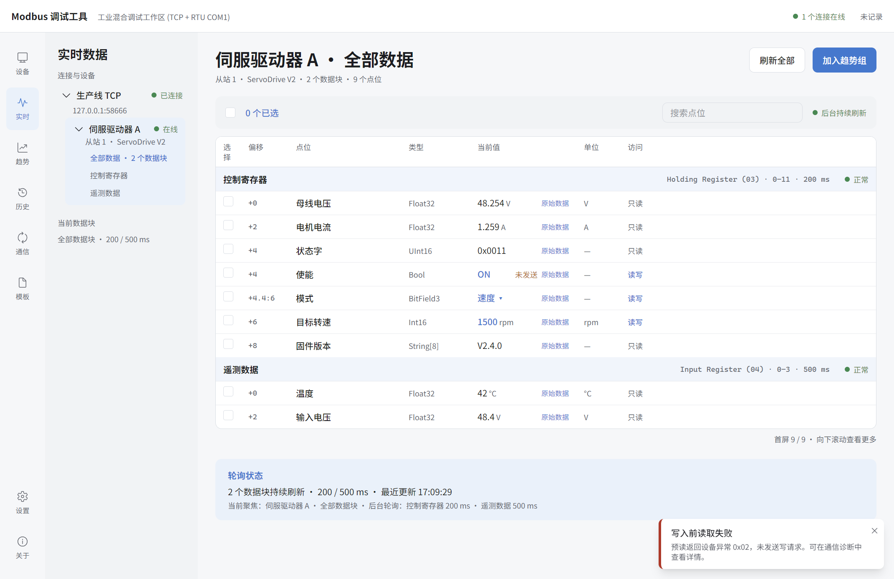
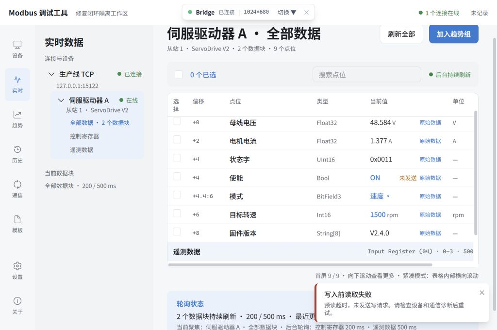

# 2026-10-20 审核问题修复与复验

## 范围与依据

修复本轮审核发现的四项问题：配置变更后的旧响应污染、开发 Bridge 缺少来源/会话校验、写前读取失败残留等待态，以及独立审查入口的数据隔离。依据 [产品语义](../project-spec.md)、[当前架构](../architecture.md)、[开发隔离规则](../development.md) 和 [项目约束](../../AGENTS.md)。本记录持续更新，不将旧版验收或前一轮测试结果记为新代码通过。

起点：`ba8df36` / 0.11.3。修复行为按项目约定递增 patch 至 0.11.4，同步 lockfile。本轮为增量修复，不执行正式发布的四种产物验收；目录构建仅用于验证当前代码的 Native 链路。保留任务开始时已有的 `.agents/` 与 `skills-lock.json`。

## 实施方案与基本验收标准

| 对象 | 修复方案 | 预先确定的验收标准 |
| --- | --- | --- |
| Block Cache / Runtime | 为缓存目标建立配置代次与 Runtime 所有者；排队操作、异步成功/错误和写后回读核对目标代次 | 地址、长度、区域、Unit、删除重建和 Runtime 替换后，旧数据与错误不得写入新缓存；A→B→A 不复用旧代次。未变化目标仍可正常轮询；取消的旧写操作不得发出写包 |
| 写入终态 | Main 返回共享的完整写结果；Renderer 消费结果，明确区分未发送、设备拒绝、未知和回读确认 | RMW 预读的异常、超时、传输失败均结束等待，保留 confirmed value，明确“未发送写请求”；实际写入仍不自动重发，回读失败保持未知，重试与正常回读仍可用 |
| Bridge 会话与权限 | 回环绑定、准确 Origin 白名单、随机会话凭据、受限命令/文件范围；会话入口由本机文件提供 | 无 Origin、非法 Origin、缺少/错误凭据不能握手、获取 Snapshot 或事件；合法客户端能操作真实 Main 并接收 delta；文件访问不能越出审查根目录或经链接越界；正式 Renderer 使用 Native 通道 |
| 独立审查入口 | 使用统一存储目录解析；默认独立测试目录，显式参数优先；仅在显式指定时复制工作区来源 | `--data-dir` 优先于 `MODBUS_DATA_DIR`，拒绝相对/不可写根目录且不回退；不自动加载日常工作区、仓库夹具或探测 COM1；UI 编辑只保存副本，原文件与日常偏好不变 |

缓存链路：`细粒度命令 → configure / ensure(新代次) → 旧请求收尾 → 代次校验 → 丢弃过期结果 → 当前目标正常轮询`。预读失败在 Main 形成“未发送”终态，不通过伪造 write 事务驱动 UI。

## 验证范围

- 定向 Unit / Integration：旧请求与配置竞态、RMW 各种失败与回读、共享 DTO / Renderer 写入状态、Bridge 鉴权/命令/文件范围、入口目录优先级与副本。
- 对应独立 PyModbus TCP 互操作；RTU 无指定硬件时明确未验证，不以 Fake/TCP 代替。
- TypeScript、相关 lint、文档链接及差异检查；最终收敛后执行一次相关回归，不机械重复全量。
- 内置浏览器连接修复后的真实 Main / Bridge：正常写入、预读异常/超时/恢复、缓存确认值和通信证据；检查 1440×960 与 1024×680 受影响界面。会话凭据缺失/非法时明确失败，不回退 Mock。
- 当前目录构建与定向 Native E2E：真实 IPC、预读失败结束、正常写后回读、配置/文件保存；不拿既有 0.11.3 包证明修复通过。
- 所有运行数据、模拟器日志、截图与临时配置使用 `out/test-temp/`；结束后关闭本轮进程、监听和浏览器尺寸覆盖。

## 执行记录

阶段：四项问题修复完成，最终代码与 0.11.4 目录版复验通过；后续提交与发布状态见 [0.11.4 正式发布验收](../archive/acceptance-v0.11.4.md)。原有未跟踪的技能资料保持原状。

| 项目 | 状态 | 实际结果 |
| --- | --- | --- |
| 缓存配置竞态回归 | 通过 | 新增 13 项，覆盖寻址变更、A→B→A、删除重建、Runtime 接管、旧超时、排队写入、预读后/发包间隔内变更及旧写回读；旧版最初 11 项失败，修复后全部通过。仅改名时仍正常接收合法响应 |
| 写前失败及写后确认回归 | 通过 | Main 三类预读失败均返回 not-sent，无写包、确认值保持，随后重试成功；已发送但回读失败返回 unknown。组件覆盖相同失败与命令先于 delta 到达的边界，成功标记等 Main 回读 delta 同步更新 |
| Bridge 来源/会话/文件边界 | 通过 | 16 项定向测试通过。最终真实服务探针：缺少凭据、错误凭据、不可信 Origin 带有效凭据均 403；合法会话 101。目录外导出失败且未生成文件，目录内导出成功；junction 越界另有测试 |
| 独立入口隔离 | 通过 | 4 项定向测试通过；真实 CLI 同时给 CLI 与环境目录，实际仅使用 CLI 目录，环境目录未创建。显式工作区保存路径为根目录内的新副本，来源文件逐字比较不变；无 COM1 探测和隐式夹具加载 |
| 静态检查与 TCP 互操作 | 通过 | 最终 lint / typecheck 退出 0；应用最终候选 Vitest 48 文件、387 通过、7 RTU 硬件跳过；随后仅增加旧审查脚本会话地址适配，新增工具文件的 5 项定向测试通过，合计 392 项互异用例通过。独立 PyModbus TCP 八种 FC、边界、故障、RMW、回读与新数量过滤均通过；Python CLI 2 项通过。文档链接与差异检查通过 |
| 真实 Browser 交互与视觉 | 通过本轮场景 | 内置浏览器连接重启后的最终真实服务；1440×960 正常 RMW / 回读、0x02 未发送，1024×680 超时未发送与恢复均实际操作并查看。确认值保持、等待结束、错误原因可读、工程列内部滚动；Renderer 无 error 日志。无凭据入口明确报错，不加载 Mock |
| 当前目录构建与 Native 验证 | 通过 | 最终 Production Vite / Forge 目录构建成功；当前目录版 3 份 Spec 共 14 项通过（通用 9、桌面设置 3、真实预读故障与恢复 2）。版本实际为 0.11.4 / Electron 33.4.11；不是旧发布包 |

### 收敛中发现并处理的边界

- Native 新超时用例初次把前一用例恢复时的写事务计入本次断言；现以操作开始前的 traceId 集合划定本次事务，保留“本次绝不发送写包”的断言。定向复验 2 项通过后，在最终目录版再次运行全部本轮 14 项，均通过。
- 真实界面发现成功命令回复可能先于数据 delta；现保持等待至 Main 回读 delta 同时更新确认值与标记，增加相关组件回归，并重建、复验最终候选。
- RTU 与独立 TCP 的既有低层写测试曾只初始化 Cache。现显式配置 Runtime 目标后再执行同样的写超时/quiet recovery、RMW、String 断言，没有删除或降低原断言。
- 核对全部调用方后，同步四个旧审查驱动的会话地址读取，新增 5 项工具回归并再次通过 lint / typecheck。它们没有被用于代替本轮内置浏览器审查；只修改独立工具，不影响已测试的应用 bundle，未因此重跑无关应用用例或重新打包。

### 候选与证据

最终目录：`out/Modbus Debugger-win32-x64/`，`resources/app.asar` SHA-256：`B31A09D6B071E49ACA5C93B5387B4B318506AA39B4A9A2A854083C084736AA41`。正式 `release/` 旧产物未替换。

可重建的原始证据位于 `out/test-temp/audit-fixes-20261020/`：`vitest-final.log`、`package-final.log`、`native-e2e-final.log`、`bridge-final-probe.json`，以及 Browser / Native 截图和实际事务 JSON。Bridge 为独立 Backend 会话，Native 为打包版 IPC 会话，各自使用不同隔离根目录；不争用历史库或设备。原始证据含本机路径，不作为正式发布资料。

下列两张关键截图已择要保留，其他批量截图不进入 Git。

原生目录版：实时页“使能”输入 OFF，FC03 预读返回 0x02；设备确认值仍为 ON，显示未发送及原因，无写入转圈。

Browser Review，1024×680：预读超时后确认值仍为 ON，提示未发送写请求，表格使用内部滚动。恢复正常模拟器后再次通过界面写入，确认值变为 OFF，状态字从 0x0011 变为 0x0010，其他位保留。

结论：本轮四项审核问题已闭环。真实 RTU / 现场硬件未验证；正式四种产物 Smoke、容量/长稳和完整发布验收不在本轮范围，不据此宣称正式发布验收通过。
