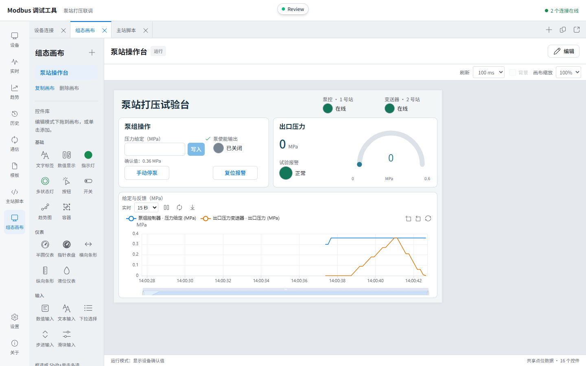

# 泵站打压与卸压联调

用同一套业务流程验证主站、软件从站、组态画布、Blockly、实时数据、趋势和通信诊断。默认工作区只连接本机回环地址，自动化从工作区副本启动，配置、历史库和采样导出位于隔离目录。



## 运行示例

1. 复制[泵站工作区](../examples/pressure-bench.workspace.json)，在上位机「设置」的工作区操作中打开副本。在「设备」选择「现场从站服务」，点击「启动从站」。主站会自动连接到 `127.0.0.1:15032`。
2. 在项目根目录执行下列命令启动[压力模型](../../tools/simulator/pressure_bench.py)。模型使用独立的 Modbus TCP 客户端读取实际泵使能和设定寄存器，只向变送器写入反馈。每 200 ms 最多升压 0.03 MPa 或卸压 0.05 MPa。

   ```powershell
   python -m pip install -r tools/simulator/requirements.txt
   python tools/simulator/pressure_bench.py
   ```

3. 打开「组态画布 → 泵站操作台」。两盏通信灯应显示在线，起始给定为 0.30 MPa，出口压力为零。输入 0.36，点击控件内的「写入」。
4. 打开「主站脚本 → 升压、达标与卸压」，点击「运行」。可切回画布看反馈曲线，也可在脚本底部查看目标、实测达标值和卸压终值。仪表与流程读取同一份主站确认值。
5. 若要复现传感器有应答但读数不动，在一轮结束、出口压力为零时用 Ctrl+C 结束压力模型，再运行一轮。观察报警灯和错误日志。重新启动模型，在画布点击「复位报警」即可再试。

| 设备与零基地址 | 含义 |
| --- | --- |
| Unit 1，Coil 0 / 1 | 泵使能 / 报警锁存。主站通过 FC05 写入，FC01 读回。 |
| Unit 1，HR 0 | 压力给定。原始值 36 表示 0.36 MPa。 |
| Unit 2，HR 100 / 101 | 出口压力 / 台架型号 0x5054。操作台以只读点位使用压力，独立模型通过现场端的保持寄存器更新测量值。 |

流程要求本轮给定在 0.10–0.60 MPa 范围内，并在启泵前取得新的低压读数。等待达压上限为 6.5 秒。错误处理会发出停泵与报警锁存命令，并在日志里注明是否取得应答。

「泵使能输出」显示控制器线圈的确认状态。「出口压力」来自独立变送器，流程用这一读数判断是否达标。报警锁存后，重新运行会提示先复位。手动停泵按钮可以在通信恢复后撤销使能。

## 验收条件

| 场景 | 要看到的结果 |
| --- | --- |
| 设定值 | 画布输入 0.36 MPa，提交前主站、从站与独立客户端均读到原值。提交后查到匹配的写应答，寄存器为 36。 |
| 打压和卸压 | 流程等到新的压力采样后启动泵。独立过程模型根据泵线圈和给定值改变 2 号站的测量寄存器。压力从零分多次升到给定值，流程停泵，压力回到零。画布、日志、趋势和采样 CSV 可相互核对。 |
| 有应答但无升压 | 保持压力反馈不动，两台设备仍在线。达压等待超时，走错误分支，停泵、锁存报警后停止流程。报警未在画布复位时再次运行，流程提示闭锁且不发启泵命令。 |
| 单站无应答 | 让软件从站中的 2 号站停止应答。保持主站 TCP 连接和 1 号站在线，画布单独显示 2 号站离线。没有新的传感器读数时流程不能启动泵。恢复后复位报警并再次完成循环。 |
| 升压中丢失单站反馈 | 在泵已启动、压力尚未达标时，仅丢弃发往主站的 2 号站应答。1 号站须继续应答，超时分支经原连接取得停泵与锁存应答。恢复传感器应答后主站重新确认该站在线。 |
| 地址异常 | 访问 2 号站未定义的地址，返回异常码 02，设备保持在线。 |
| 链路中断 | 在升压期间关闭从站监听，观察超时、停泵命令的实际结果和恢复后的线圈值。流程日志须能区分已确认的停泵与未确认的输出。 |
| 串口与持久化 | 在可用的虚拟串口对上复验同一流程，主站从串口读取现场反馈。重载工作区后确认设备绑定、画布、流程及趋势仍可使用。 |

## 2026-11-23 实测结果

Windows x64 目录版 0.30.0 的三项端到端用例全部通过。前两项覆盖 TCP 正常工况、故障与恢复，第三项沿用同一工作区的画布、模板和流程，仅将传输切换到 19200、8N1 的 COM1 ↔ COM2 虚拟串口对。TCP 压力由独立的 PyModbus 进程驱动。RTU 在软件从站侧逐级设置反馈，由主站通过串口重新采样。

| 实测项 | 结果 |
| --- | --- |
| 画布写入与单步 | 输入 0.36 时，主站、从站和独立客户端仍读到原始值 30。提交后读到 36，主从两端 FC06 请求和应答 PDU 均为 `06 00 00 00 24`。单步执行启泵积木前，独立客户端读到使能关闭。执行后读到使能开启。完整正常循环只有一笔启泵和一笔停泵写入。 |
| 流程、曲线与导出 | 正常循环结算 13 步，日志依次记录目标 0.36、达标 0.36、卸压 0 MPa。TCP 本轮取得 43 个压力采样，两信号 CSV 共 86 行数据。RTU 取得 10 个压力采样，CSV 共 20 行数据。两次都逐条比对了确认缓冲和 CSV 里的反馈值及顺序。 |
| 反馈冻结与闭锁 | 变送器持续应答、压力始终为零，达压等待在约 6.5 秒后超时。控制器实际使能关闭、报警锁存。报警未复位时重跑只记录闭锁提示。画布手动复位并恢复模型后，流程再次通过。 |
| 单站掉线与异常应答 | 同一 TCP 连接上，2 号站连续第 1、2 个轮询超时后仍在线，第 3 个超时后变为离线。1 号站全程在线。离线状态启动流程时，启泵前的采样等待在约 1.8 秒后超时，未发出启泵命令。另读 Unit 2 的 HR 900，收到 `83 02`，该站仍在线。 |
| 运行中只丢 2 号站应答 | 在升压时，回环测试链路丢弃 31 个 2 号站回复。主站最后的确认压力为 0.03 MPa，流程没有误判达标。原 TCP 会话持续使用，1 号站应答停泵和锁存命令。独立客户端核对使能为关、报警为开。恢复回复后 2 号站重新上线。 |
| 运行中整条链路中断 | 停止现场从站服务后，流程记录“停泵或报警锁存未获确认”。服务恢复时，独立客户端读到使能仍开、报警未锁存。在画布点击「手动停泵」后再次读取，才确认使能已关。 |
| 工作区重载和界面 | 保存并重开后，两个现场 Unit、16 个画布控件、流程和两个趋势信号的绑定完整。实际界面核对了主站与本机从站的实时值、通信诊断、Lua 预览、运行日志，以及画布和趋势页上完整的升压、卸压曲线。在 1024×680 窗口将画布设为 75% 后，状态灯、设定、停泵和复位均可见。 |

验收时内置浏览器受 Windows 桌面访问限制，界面审查通过 Playwright 操作连接真实 Main 的 Browser Review Mode 完成。原生交互和通信在打包的 Electron 中复验。[自动化用例](../../tests/e2e/pressure-bench.e2e.ts)会在 `out/test-temp/pressure-bench-evidence/` 留下两个传输的采样 CSV、主从报文、各故障运行 JSON、Lua 和截图。

按项目约定准备目录版后，用 `npm run test:e2e -- --spec tests/e2e/pressure-bench.e2e.ts` 可复验 TCP 场景。使用上述虚拟串口对复验 RTU 时设置 `MODBUS_SELF_RTU=1`，将 COM1 与 COM2 都留给应用内的主从两端。
