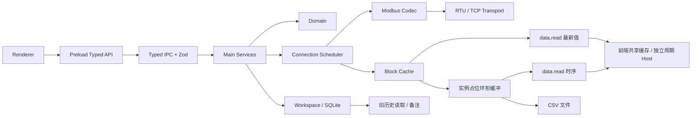

# 当前架构

本文件记录现行实现契约；产品语义见 [project-spec.md](project-spec.md)，历史故障与验证过程见 [full-audit.md](archive/full-audit.md)。

## 主站 / 从站 Runtime

`ConnectionDef.role` 可选 `master` / `slave`，缺省按主站解释，保持 schema v1 的旧文件兼容。`RuntimeManager` 根据角色创建 `ConnectionRuntime` 或 `SlaveRuntime`，共用现有关闭屏障、Block Cache、DiagnosticsStore、Snapshot/delta 与采样缓冲。下文 Scheduler、主动写入和扫描规则适用于主站。

```text
Renderer --Command--> RuntimeManager
                         +-- master: ConnectionRuntime -> Scheduler -> Transport
                         +-- slave:  SlaveRuntime <- TCP Server / SerialTransport
                                         |        请求 Framer -> PDU 校验 -> 原子读写
                                   Block Cache -> 响应 / 最新值读取
                                         +------> 点位采样缓冲 -> Host 读取 / CSV
```

请求解码/执行位于纯 TS `domain/protocol/slave.ts`，验证完整 PDU、数量、ByteCount、地址和值后，通过同步内存适配器预验证全部连续段并提交缓存。网络读取使用同一点位可读范围计划，FC22 在本机内存执行原子掩码更新。独立的 `slave.setValues` 命令允许在 Main 设置四类本机内存，`point.write` 在从站角色进行本地原子映射编辑。主站通过设备写应答结算命令结果。

TCP Server 每个客户端独立 Framer，保留请求 TID，最多 32 个客户端，单客户端发送积压上限 64 KiB。RTU 复用正式 SerialTransport，按请求预期长度/CRC/可信边界/有界等待分帧，不依赖字符间隔；响应串行发送，队列最多 128 项。长输入按 ADU 上限分段送入缓冲；截断 TCP 候选超时后保留后续可信帧。

从站连接加载后不自动监听。已启动连接发生错误时按配置恢复，手动停止取消恢复；正常停止等待正在打开的设备，关闭监听和所有客户端，结算串口响应并释放句柄。Windows 串口关闭屏障包含 20 ms 的驱动取消读取完成窗口，避免虚拟串口有活动读取时立即重开报告 Access denied。

`SlaveDef.initialValues` 保存 blockId/area/start/values，只加载与当前块定义完全匹配的初始值。网络写入不改 Workspace；`slave.saveInitialValues` 显式采集当前值并通过 WorkspaceService 原子保存。配置重建通过 owner/generation 失效旧内存，启停同一个 Runtime 保持当前值。

## Runtime



## 跨进程契约与工作区编辑

- `src/shared/contracts.ts`、`commands.ts` 和 `snapshot.ts` 定义跨 Main / Preload / Renderer 的类型与命令；Main 内部类型不得被 Renderer 或 Shared 反向引用，ESLint 对此设边界检查。
- 连接、从站、模板、数据块、点位和趋势编辑通过细粒度命令进入 Main。`mutateWorkspace()` 基于 Main 当前 Workspace 生成并验证新状态；生产界面不提交完整 Workspace。`workspace.apply` 只保留给隔离的测试 fixture 和内部工具，正式打包的 IPC 默认拒绝此命令。
- 工作区变更发布 Snapshot / delta；连接配置替换须等旧传输关闭后才启动新传输。历史记录、Block Cache 与 Scheduler 仍由 Main 统一维护。
- Block Cache 为每次目标绑定维护独立 generation 和 Runtime 所有权。地址区、地址、长度、Unit、Runtime、读取计划变化及删除重建使旧操作失效，排队操作、轮询成功/错误、RMW 预读及发写均核对代次。Main 另外维护写入绑定 epoch，点位权限、映射和换算的 A→B→A 修改也会撤销旧在途命令的显示结果。
- Main 的 `PointWriteResult` 区分 `not-sent`（预读失败、未发写包）、`rejected`、`unknown` 和 `confirmed`。匹配的正常写应答表示 confirmed，设备确认值来自 Block Cache。Main 的 `PointWriteReceipt` 随最新点位读取携带最近尝试及最近成功命令，供只写控件投影，运行结束释放该记录。

```text
写控件 -> point.write -> [读写部分字段的最新预读] -> FC05/06/16 或 FC22
                                                       |
                                                 匹配写应答
                                                       |
Main 命令记录 -> Host 最新值读取 -> 成功/拒绝/未知与上次成功命令

可读范围轮询 -> 实际设备响应 -> Block Cache 有效地址 -> 点位值与采样缓冲
```

读取计划位于 `domain/point-access.ts`。完整块中仅由 wo 映射占用的地址被排除，可读别名保留实际读取。所有映射均为 wo 时计划为空，写入目标继续有效。连续范围按协议上限分片，尽量保持每个映射完整，重叠长映射通过补充覆盖范围保证每个样本具有完整响应依据。缓存按响应合并和维护有效地址，曲线只追加本次范围完整覆盖的可读点位。

## 开发 Browser Review

组态画布与工作台相关 Browser Review 同样使用真实 Backend。`canvas.*` 与 `workbench.saveLayout` 的显式或隐式保存路径须位于本次审查根目录，不能通过新命令绕过文件边界。

- 原生 IPC 与独立审查服务复用 `AppBackendService`。Bridge 只绑定回环地址，WebSocket 握手校验准确 Origin 白名单和每次启动随机生成的会话凭据；鉴权前不提供 Snapshot、版本或事件。普通健康检查不披露会话信息。
- 本机 `temp/dev-bridge-session.json` 保存带凭据 fragment 的 `reviewUrl`；Renderer 用 WebSocket subprotocol 提交凭据，拒绝向非回环目标发送凭据。凭据不出现在 HTTP 查询参数或启动日志中；缺少凭据时明确失败，不回退 Mock。
- Bridge 使用命令白名单，并将显式及隐式文件读写约束在本次数据根目录；校验真实父目录以拒绝 junction / 符号链接越界。原生文件选择器、安装更新、完整工作区替换等能力只走相应桌面或隔离测试入口。
- 独立 `review:bridge` 默认使用 `out/test-temp/review-*`；显式数据目录须专用于审查，不接管已有日常程序数据。仅显式 `--workspace` 来源会先复制到根目录内再加载；不自动打开仓库夹具、探测 COM1。启动方式见[开发说明](development.md#browser-review-mode)。

## Modbus Client Core

- `domain/protocol` 自研纯 TypeScript PDU / RTU / TCP Codec 与 request/result model。
- 正式范围包含 FC01 / 02 / 03 / 04 / 05 / 06 / 15 / 16 / 22。写应答需匹配地址、写值或数量，FC22 需匹配 AND/OR 掩码。
- 接收路径分层为 `Transport → Streaming Framer / Parser → ADU Validator → PDU Decoder`；Transport 只交付任意 byte chunk，不承担“一次 read/recv = 一帧”的假设。
- **TCP Framer**：基于 MBAP Header 的 Protocol ID / Length 等字段判断候选帧长度；不足一帧继续缓存，完整后逐帧 emit，并继续解析同一 buffer 中后续帧。非法 MBAP / Length 必须触发受控 Resync，不能无条件 `buffer.clear()`。
- **RTU Framer（不依赖字符间隔时序）**：本实现**不使用 t1.5 / t3.5 作为分帧判决，也不作为诊断 hint**，且不保留任何 strict/时序模式开关。理由：USB 串口驱动与操作系统调度会把字符间隔拉伸到远超协议值，以间隔判帧会在真实链路上产生大量假“不完整帧”。分帧依据固定为四条：
   1. **预期长度优先**：结合当前 in-flight 请求的预期响应长度（Unit ID + FC + 响应形态）切帧，天然处理半包/粘包混合；
   2. **可信边界扫描**：无请求上下文时在缓冲中扫描第一个 CRC 自洽的帧，扫描起点之前的字节按噪声/坏帧丢弃并记录 Resync 范围；
   3. **CRC + PDU 长度/功能码校验**：候选帧校验失败记 `crc` / `malformed`，并在候选内继续扫描被粘连的合法帧；
   4. **有界等待**：候选帧长期不完整受 `incompleteTimeoutMs` 与接收缓冲上限约束，记 `truncated` / `overflow`，不会无限等待或无限增长。
- 标准尺寸边界固定为 PDU ≤ 253 bytes、RTU ADU ≤ 256 bytes、TCP ADU ≤ 260 bytes；TCP / RTU 的 buffer 上限和异常等待边界必须围绕这些协议上限设计，超长 Length、连续垃圾数据或永远不完整的候选帧不能导致无限等待或内存增长。
- 合法 Exception Response 单独归类，不得误判为 malformed frame；结构合法但与当前 in-flight request 不匹配的响应归为 `Unexpected Response`。协议结果至少区分 `OK / Exception Response / Unexpected Response / Timeout / CRC Error / Malformed Frame / Transport Error`。
- TCP 使用 MBAP Transaction ID 做线上请求关联，但它与应用 `traceId` 分离；迟到的旧响应可依据 Transaction ID 识别并丢弃/记录，不得关联到后续请求。
- RTU 超时即结束本次等待并清理过期半包，保留超时事务上下文供空闲期间的 late/unexpected 诊断使用。发送下一条前再次清理事务间残留，并根据最近串口收发活动满足发送侧帧间静默。接收分帧继续依据长度和 CRC。RTU 同站号、功能码、长度的迟到读取应答存在归属歧义，用户配置的超时应覆盖设备正常处理时间，固定附加恢复窗口的保护范围有限，现行实现已移除该窗口。
- 对当前请求已知的 Unit ID、Function Code、预期响应形态/长度要作为 Framing 与匹配上下文，减少噪声或旧响应被误接受的风险。
- Framer / Validator 不得静默吞掉协议异常：至少输出结构化 parse/error event，记录错误类型、原因、相关 Raw Bytes、Resync 丢弃字节数/范围以及关联的 connection/request context；诊断层据此生成 Transaction / communication diagnostic 记录。

## Connection Scheduler

- 每 Connection 独立 Runtime / Scheduler，当前 RTU / TCP 均 `maxInFlight = 1`。
- Block.periodMs 允许 0–60000 ms 整数，0 表示尽快采集。周期从选中该块时计算，下次到期后参与调度，同到期时间按上次调度顺序公平轮转。任务完成通过 `setImmediate` 唤醒调度并让出 I/O，未来块和轮询重试按各自截止时间唤醒。5 ms 定时检查继续处理分帧维护和重连。
- Connection.retryDelayMs 允许 0–60000 ms 整数，旧工作区缺省按 50 ms 解释。常规轮询的失败重试释放执行槽，在连接级间隔到期后重新参与轮询，同一块保留一个重试状态。混合块每个读取片段结束后重新参与调度，周期从首片段选中时计算。事务的 pollCycleStart 标记首次片段的首次尝试，块实际周期按该标记统计，各片段的耗时及失败继续纳入通信诊断。手工读取、扫描及 RMW 预读沿用连接重试间隔，停止连接或扫描取消对应等待。
- Connection.interFrameMs 表示上次请求结束到下一次发送的最短间隔，缺省 0 ms，界面位于高级连接参数。请求间隔、重试间隔和 RTU 发送静默按各自截止时间重叠计算。
- 优先级：写确认序列 → Temporary Read / 手工诊断 → Periodic Poll。
- RTU Scanner 独占该 Connection；扫描期间暂停 Poll，结束后恢复。
- 从站扫描按输入范围（1–247）依次发送读取探测。默认 FC03 / Start=0 / Qty=1 / timeout=150 ms / 重试沿用 Connection.retries；扫描页 Unit 范围下方提供默认折叠的“高级扫描配置”，可选择 FC01/02/03/04、0-based 起始地址（0–65535）、超时（10–10000 ms）、重试（沿用连接或 0–5 次）。Qty 固定为 1，FC01/02 表示 1 位，FC03/04 表示 1 个寄存器。设置仅覆盖本次扫描，不修改连接配置；扫描与停止收尾期间锁定控件，折叠不会重置设置。
- `device.scan.options` 使用共享 Zod schema 做 IPC / Runtime 校验，拒绝写功能码、非整数、越界值和非固定数量；未携带 options 的旧命令沿用默认行为。生效后的 options 存入 Main 扫描 Snapshot，页面重新打开时能显示正在执行的参数。超时/传输失败按本次生效 retries 和连接 retryDelayMs 重试。扫描按目标从站应答登记发现结果及异常码，网关错误保存于诊断。
- Scanner 阻止当前连接新增 Poll / 手工请求进入执行，等待正在执行的事务或 RMW/Write 原子组完成后再占用执行槽。`device.stopScan` 请求停止，当前已发出探测正常收尾，取消重试等待，保留已发现结果，释放执行槽并唤醒队列/轮询。RTU 发送继续遵守帧间静默。断开连接也结束扫描，同一连接拒绝重复扫描。
- 扫描进度、停止状态、实际已检查地址数和部分结果由 Main Runtime 保存，通过 Connection Snapshot / delta 下发；切换页面再返回仍可查看并停止当前扫描，Renderer 不设后台查询 Timer。
- 临时读取默认 FC03 / Start=0 / Qty=10，用户可修改数量；只发起一次手工读取操作，沿用连接的超时/重试策略，不新增周期轮询。
- 临时读取 UI 禁止重复提交，离线/扫描中说明不可读取原因；Main 离线调用立即拒绝。停止连接或传输中断时必须 reject 尚未发送的排队操作，防止 Renderer 永久等待。读取失败显示 Main 结果分类、异常码/含义与请求上下文，允许进入通信诊断查看原始记录；timeout 文案表述为“未收到有效匹配的响应”，不能断定设备没有发送任何字节。重试失败清除旧结果，成功数据和保存 Block 操作绑定提交时参数。
- `Write → Read Back` 不可被 Poll 插入；部分寄存器 `Read latest → Mask/Merge → Write → Read Back` 是原子调度组；Write Timeout 后 Read Back 仍属于同一确认序列。
- 周期、Timeout、latency 使用 monotonic clock；展示/持久化同时保存 UTC wall-clock timestamp。
- 连接生命周期：`connection.connect` / `connection.disconnect` 记录**用户意图**（RuntimeManager.userOffline）。配置编辑会重建 ConnectionRuntime，重建时保留该意图：显式断开后保存不会自动重连，必须再次点击「连接」；应用启动时意图集合为空，按原有行为自动建立链路。
- Connection.reconnectIntervalMs 为每次失败或断开后到下一次自动尝试的固定等待，允许 0–60000 ms，旧工作区缺省 1000 ms。主站和本机从站均使用该值，重复 error/close 事件保留首次截止时间。成功后仍采用同一间隔。0 表示在下次调度检查时继续尝试。
- Connection.connectTimeoutMs 允许 1–60000 ms，旧工作区缺省 3000 ms，用于 TCP 建连、RTU 打开和 flush 就绪，以及本机 TCP 监听启动。Connection.timeoutMs 对单次 Modbus 请求等待应答计时。连接成功后清理建连定时器，超时、手动取消和迟到回调按各次尝试的资源身份处理。
- TCP 在握手完成前保存 Socket，以支持取消待连接请求。SerialTransport 保留尚未完成的驱动打开操作，超时或取消后结算调用，迟到打开成功后立即关闭，新的驱动打开等待旧操作释放。主站 Snapshot 与手动连接结果包含实际错误原因。连接设置页在 connecting 状态提供断开操作。
- 设置页锁定：连接处于 online / connecting 时参数表单整体禁用（含串口/波特率下拉），避免运行中改参数撕裂传输；断开后可编辑，保存后仍保持离线直到用户连接。扫描 / 临时读取同样要求连接状态。

## Transaction

每个事务至少记录 `traceId`、connectionId、unitId、functionCode、sourceKind/sourceId、UTC start、monotonic duration、Raw ADU/PDU、result、Exception Code；TCP 另存 `mbapTransactionId`。

## Simulator / Fixtures

- Unit / Integration 使用 Fake Modbus Transport，除 response、delay、timeout、exception、disconnect 外，还必须能够按任意 chunk 边界交付接收字节，以制造半包、粘包、混合切分、噪声和坏帧后正常帧。
- `tests/fixtures/protocol/` 保存独立 Golden RTU/TCP request / response / exception / CRC vectors，expected bytes 禁止由被测 Codec 生成。
- Streaming Parser Fixtures 必须覆盖合法帧的多种切分方式，以及 malformed frame 后紧跟合法帧的恢复序列。
- Standalone Simulator 优先 Python PyModbus，与正式 TypeScript Client 独立；TCP Simulator 必须进入 E2E。
- Windows 无稳定虚拟 COM 时，RTU 自动回归以 Golden + Fake Transport + serialport Mock 为硬门槛，同时保留真实/虚拟串口 Smoke Test。

## 构建与打包（Vite）

- Windows 发布由 Forge 完成目录版与 ZIP，再在 `postMake` 中使用 electron-builder 的 `prepackaged` + NSIS 封装 Setup 与 Portable。Setup 使用上游安装向导并启用目录选择；Portable 使用 `build/portable-launcher.nsi` 自定义无安装脚本。同一份 Forge/Vite 目录用于全部产物，不重新编译应用。
- `out/` 保存 Forge 产物与 Portable 构建中间文件；`release/` 根目录直接存放四种交付产物，不增加版本/平台子目录。命名统一为 `modbus-debugger-<package.json version>-win-<arch>`，目录版本体不加后缀，另三项分别追加 `.zip`、`-Portable.exe`、`-Setup.exe`。全部构建成功并校验版本后才整理到 release；成功后清理命名匹配的旧版本产物，只保留当前版本，同版本其他架构可并存。替换与旧产物清理共用临时备份，失败回滚；其他文件不清理。
- Portable 启动器只使用 NSIS 内建文件/进程指令，创建外层 EXE 下 `temp/<独立目录>/app`，通过 `--portable-dir` 把外层目录传给 Main，正常退出后删除本次解压目录；不加载会落到系统 TEMP 的 NSIS 插件。Main 仍兼容旧启动器的 `PORTABLE_EXECUTABLE_DIR`。
- Setup 使用 current-user NSIS 安装向导（oneClick=false、allowToChangeInstallationDirectory=true），不强制管理员权限；`APP_BUILD_DIR` 直接嵌入已打包文件。`customRemoveFiles` 按打包清单删除程序并保留用户数据；旧 Squirrel 安装不自动卸载或迁移。

- 构建插件：`@electron-forge/plugin-vite`（forge 7.x）。三份配置分别对应三个 target：
  - `vite.main.config.ts`：Main 进程，CJS 输出到 `.vite/build/index.js`；`sql.js` / `serialport` / `@serialport/*` 声明为 external（原生或 UMD 模块不能进 bundle）。
  - `vite.preload.config.ts`：Preload，固定输出文件名 `.vite/build/preload.js`（Main 以 `path.join(__dirname, 'preload.js')` 加载）。
  - `vite.renderer.config.ts`：Renderer，入口为**仓库根** `index.html`，输出 `.vite/renderer/main_window/`，单文件 IIFE bundle（避免 app:// 下的 chunk 瀑布与 sandbox 内动态 import 边界问题）。
- `package.json` 的 `main` 指向 `.vite/build/index.js`。
- 生产渲染层通过特权自定义 scheme 提供：`protocol.registerSchemesAsPrivileged([{ scheme: 'app', privileges: { standard: true, secure: true, supportFetchAPI: true, corsEnabled: true } }])` + `protocol.handle('app', ...)` → `net.fetch(pathToFileURL(...))`，窗口 `loadURL('app://./index.html')`。这样既避开 `file://` 下 ES module 的 CORS 限制，又不需要关闭 webSecurity；handler 只注册一次（macOS `activate` 会再次调用 `createWindow`）。
- 开发模式使用 forge 注入的 `MAIN_WINDOW_VITE_DEV_SERVER_URL`；类型声明见 `src/main/vite-env.d.ts`。
- 打包：plugin-vite 会让 packager 跳过 `node_modules`，因此 `packageAfterCopy` 钩子显式复制 external 依赖（`sql.js`、`serialport`、`@serialport`、`debug`、`ms`、`node-gyp-build`、`node-addon-api`）进 asar；`AutoUnpackNativesPlugin` 负责把 `.node` 二进制 unpack。
- Main 中禁止对被 bundle 的依赖使用裸 `require()`（rollup 会原样保留成运行时 require，而包里没有对应 `node_modules`）；只有 external 依赖（`serialport`、`sql.js`）可以保留运行时 require。

## Snapshot / Delta 与渲染性能

### 多实例视图与原生窗口

- `appStore` 初始化统一传输，接收工作区、连接、通信诊断等状态增量。`FrontendDataCache` 合并 Host 的批量读取并复用确认值和时序缓存。每页通过 `AppStoreContext` 持有独立显示快照，`useHostData` 按页面周期发布最新值、块内存及曲线数据。后台标签暂停显示更新，已保存的曲线引用继续在 Main 采样。
- `workbench/workbench.tsx` 为每页维护稳定 DOM 挂载点和 React Portal。首次激活时先连接并显示挂载点，再挂载页面，避免尺寸组件和虚拟表格在无布局尺寸时缓存错误偏移。之后切换页面保留组件树。隐藏画布的几何定义更新延迟到再次可见时应用。弹出时把挂载点移到同源窗口宿主页，回入时移回主工作台，保留组件状态与滚动。子页入口不再初始化 App/Backend。
- `view-windows.ts` 由 Main 允许应用自身的宿主 URL，维持 sandbox、contextIsolation、禁用 nodeIntegration。窗口关闭由 Main 发出 typed 请求，Renderer 移回视图后确认关闭；Main 页面重载/退出回收子窗口。窗口坐标经显示器边界约束后保存在本机偏好。
- 所属 document/window/弹层容器由 `ViewEnvironmentContext` 提供；下拉、对话框、全局键盘和侧栏拖动按所属窗口注册。ECharts 跨文档移动时重建绘图实例，样本和页面视角仍由保留的视图状态提供。每页错误边界允许局部重试，避免单个页面异常卸载整个工作台。
- `src/shared/workbench.ts` 校验模块、选择状态与当前页引用。持久化仅发送 `workbench.saveLayout`；临时草稿、React 回调、运行数值和窗口坐标不进入可移植布局。

### 画布编辑与元数据更新

- `domain/canvas.ts` 定义受限控件与画布 schema；不支持工作区内的任意 JavaScript/HTML 执行。Renderer 保留编辑基线、草稿和最多 100 步撤销历史，通过 `canvas.create/edit/delete` 提交。
- 容器以 `parentId` 和相对坐标保存，`canvas-geometry.ts` 统一祖先、世界坐标和选择子树运算。`CanvasScene` 为每个控件保留稳定 Portal 挂载点，在所属容器连接且可见后挂载尺寸组件，重挂父级保留写入草稿。`CanvasItem` 用 Pointer Capture 处理拖动并集成 `re-resizable` 处理尺寸，支持 DOM 跨原生窗口移动后的事件。Main 校验层级、深度、边界及全部曲线信号引用。
- 每张画布的 `grid` 保存 visible、snap 和 size，缺省开启显示及吸附、间距 8 px，可配置 2–128 px。`canvas-grid.ts` 在画布坐标中吸附移动边缘，容器原点和缩放统一换算；Alt 临时自由调整，方向键微调 1 px，Shift+方向键按当前间距移动。显示点阵按背景明暗选择对比颜色。尺寸手柄拦截先到达的 Pointer 事件，后续 Mouse/Touch 事件交由尺寸组件处理。
- 六种对齐以同一容器内的选择根控件包围范围计算，容器后代沿用相对坐标。水平/垂直等间距固定按位置排序后的首尾控件，均分边缘空隙，计算后校验边界再进入统一撤销历史。网格和排列均经现有 `canvas.edit` 版本检查保存。
- 曲线读取共享 `live` 样本；暂停时复制已选信号及时间边界，避免滚动缓冲淘汰已暂停数据。ECharts 增加缩放、十字游标和图例交互，跨文档重建前保存缩放/图例状态；不创建独立轮询。
- 仪表样式与输入类型保存为 `gaugeStyle` / `inputMode`，共享原有控件和绑定模型。Main 在输入类型变化时重新校验绑定，即使点位 ID 未变。枚举确认值从 Main 的 rawNumber / boolValue 取得，标签沿用 enumMap。紧凑下拉使用 Radix Popper，弹层放在所属视图根节点，按触发器的实际屏幕边界定位，跨 document 时重建内部监听，运行草稿保留在控件中。
- 指示灯的二态、规则、默认状态和渐变保存为控件的 `lamp` 配置，Main 通过共享 Zod schema 校验规则 ID、有限值、边界和颜色。`canvas-lamp.ts` 只基于确认值做纯函数匹配，Renderer 将选中状态渲染为灯面与文字。旧配置缺省为二态且亮色跟随原主题色。编辑器在本地数值/颜色仍有草稿时保留基线，组合框键盘事件交给其所属控件处理。
- 编辑态预览仅由 `CanvasEditor` 的 React 状态持有，按控件 ID 注入显示投影，正式定义及 `diffCanvas` 不包含它。`preview.ts` 生成数值/文本/Bool/枚举的临时显示数据，灯可强制查看被前序规则覆盖的状态与默认状态；曲线生成局部示例数组，不追加到共享 `live`。写入入口仍检查编辑态，模拟外观不授予操作权限，画布内预览控件退出 Tab 焦点顺序，模拟输入不创建运行草稿。进入运行时清空映射，显示组件也独立忽略非编辑态的预览参数。稳定视图 Portal 在弹出/回入时保留映射；画布或视图卸载时释放，不引入 Main/IPC/存储契约。
- `canvas.edit` 为带 `expectedRevision` 的原子批量变更（元数据、控件 upsert/remove/order），Main 基于当前定义应用并校验边界、重复 ID、量程和新绑定；不会替换其他画布或工作区对象。过期版本拒绝，既有失效绑定保留供界面修复。
- 工作台/画布修改不重建 Runtime，也不清除缓存。Main 发布 `workspaceMetadataOnly` delta；Renderer 合并可能同时到达的点位增量，保留未变的离线确认值，且不制造趋势样本。
- 普通配置变更仍使用完整绑定更新语义。可并行编辑的对象 upsert 接受可选 `expected` 基线；生产编辑表单携带基线，Main 拒绝同对象的过期提交，互不相关的编辑可继续。

各 ConnectionRuntime 按请求完成和到期时间唤醒调度，Block 配置周期支持 0 ms 尽快采集，5 ms tick 负责定时维护。成功确认数据写入 Block Cache 后触发 `onConfirmed`，`SampleBuffers` 当次追加有效样本。RuntimeManager 的 100 ms tick 聚合诊断、连接、从站与块状态，点位值和原始块内存通过 `data.read` 按需读取。

主站积木脚本在 Workspace 保存 Blockly JSON 图。Main 将保存修订编译为受限步骤，`ScriptRuns` 以脚本 ID 管理各自的 `MasterScriptRunner`，用本轮运行 ID 路由控制命令。Snapshot 的 `scriptRuns` 包含各流程的运行记录，delta 只发送有变化的记录，以 `null` 移除。保存变量与判断直接读取共享缓存的最新有效确认值。「等待新采样」订阅覆盖完整点位范围的后续缓存确认。「等待条件」在订阅后立即检查，相关采样和从站状态通知到达时同步复查。设备通知为工作区共享，变量和定时器通知只在所属实例分发。时间条件订阅单调时钟的下一次有效相位变化，宿主唤醒稍晚时按逻辑截止点复查。等待步骤各设一个超时计时器，成功、失败、停止或超时时释放订阅。写入复用点位校验和 ConnectionRuntime，停止信号在发送前校验且可移除队列项。

Main 与 Renderer 调用同一领域编译器 `compileScriptLua`。编译器先规范化已保存或正在编辑的 Blockly 图，再从同一组语句、操作数与函数生成结构化 Lua、积木行映射和可恢复的原生 Lua 控制块。运行指纹覆盖语句、函数、事件和结构化源码。「校验」复用流程编译规则及点位下拉框的工作区绑定范围。执行边框使用 Main 上报的当前积木 ID。草稿或保存修订变化时，Renderer 对照 Main 的编译步骤摘要，支持只改断点后重新打开页面继续单步。执行内容已变化时，原运行日志保留原结果，并可通过稳定 ID 定位当前草稿中保留的积木。

脚本编译结果包含主流程及按定义 ID 索引的函数。桌面在 Lua 5.4 中执行按图编译的数值表达式；动态输入在表达式实际求值时读取。复制的 Lua 内嵌相同的运算与比较函数，保持 64 位整数、有限数值和错误规则。条件订阅包含实参及函数体引用的点位。流程函数调用沿用步骤调度和写入确认，在进入和退出时切换变量作用域。计划阶段沿可达调用收集写入，编译阶段检查调用环及展开预算。Lua 源映射包含独立函数定义、调用处和主流程。

变量观察复用上述作用域。赋值、函数进入或退出时标记变动，Main 在读取快照或结算运行时生成带原始类型的值列表。每个函数按事件来源保留最近一次调用，入口共享脚本变量，挂起的调用各自保存形参与错误处理上下文。Renderer 将当前草稿的变量名与同一脚本、同一执行内容的运行结果关联，观察点位变量不会新增轮询。

脚本保存、导入和删除先原子替换候选工作区文件，落盘成功后再发布修订和快照。替换失败时保留旧工作区、旧运行记录和重试所需的修订号。切换工作区会释放复数及兼容单值运行记录。

每个运行实例通过 Wasmoon 创建独立的 Lua 5.4 状态。编译器为实际语句序列生成 Lua 函数；每个事件在宿主边界返回时保留下一步的原生闭包。`script-handle.lua` 提供调用、循环、异常和休眠的恢复入口。Main 负责设备绑定、异步应答、断点与观察值。大整数以十进制和类型标记经 IPC 传输。启动任务先执行，`ScriptEventClock` 分别维护宿主周期回调的截止时间和各通道的定时计划。每个句柄每轮最多推进 64 个边界或约 3 ms，然后把线程交还给事件循环。设备等待通过 Promise 和设备通知恢复，Lua 调用栈先返回宿主。断点及高风险确认只暂停所属句柄。已上线路的写入先结算，再结束该实例。

`on_start` 使用该句柄唯一的受管协程。启动协程与主 L 都安装每 1000 条 Lua 指令检查一次的 count hook。启动段到达时间片可以 yield，`sleep_ms` 校验当前协程与可让出状态后 yield 给宿主计时。`on_run` 和 `on_timer` 通过主 L 的受保护调用推进。Main 启动时从流程读取 `callbackTimeoutMs` 并固定到本次运行的句柄和快照，老文件缺省取 1000 ms。每次回调从该时限开始，只累计实际调度到本回调的时间。指令 hook 和积木边界均按剩余预算检查，超时或违规休眠时触发 `lua_error`，结束所属句柄。事件图的 Lua 预览返回已定义的 `on_start`、`on_run`、`run_period_ms` 和 `on_timer(id)`。`rt` 表示宿主的周期和定时器操作，`modbus` 表示设备操作。旧顺序图继续输出直接执行的 Lua。

Renderer 生成 Lua 时按调用依赖排列局部函数，通过定义 ID 解析调用，并在每个作用域内分配参数与变量名。变量在首个直接赋值处或所属作用域入口声明。普通表达式按 Lua 的运算优先级生成，依赖设备确认态的判断保留宿主的三值求值。Main 继续执行已校验的积木计划。

图中的 `breakpoints` 保存可执行积木 ID。Main 为每次运行维护独立的断点集合。在步骤边界暂停时，Main 发布当前积木、已赋值变量和冻结的待写值，挂起该脚本的 Promise。「继续」「单步」必须同时匹配运行 ID 和本次暂停的一次性令牌。暂停请求先阻止新设备步骤派发，等待在途步骤结算；单步优先回到所选任务的下一处边界。`AbortSignal` 可结束暂停、取消后续执行。每条脚本日志复用步骤记录并带上 Main 的 UTC 毫秒时间，读取点位始终复用确认缓存。

Blockly 的默认值积木与已连接的值积木共用同一槽。编辑层将默认值保存为原有字段，Main 仅在执行时读取动态操作数。高风险动态写冻结实际值并通过运行 ID 和一次性确认令牌结算。Main 记录本次运行各条件最近一次求值事实，分段缓存按地址保留确认时间。主循环在每轮末尾让出 I/O，尝试执行的处理区只处理操作失败，停止和跳出信号按各自作用域传递。

从站通信状态由 ConnectionRuntime 根据匹配应答和完成的块轮询推进。重新连接或从站绑定改变后重新确认。轮询分片和重试在整块结束时归并失败，设备有效应答清空各块失败次数。RuntimeManager 按 `slaveId` 发布 `slaveStates` 快照及稀疏增量。设备页、实时/趋势和画布复用该状态。画布只保存指示灯的从站引用，运行状态在 Main 内存中维护。

### Host 读取与共享缓冲

- `shared/point-data.ts` 定义读取、容量、样本分页和导出结果。`sampleBuffers` 保存实例点位容量，缺省 10,000 点，单点 10–100,000，总启用容量 2,000,000 点。旧工作区缺省启用已有趋势与画布曲线引用，资源超限明确返回错误，允许逐步缩小导入配置。
- `SampleBuffers` 按实例点位建环形缓冲，`onConfirmed` 每次保留数值/Bool/枚举/String 有效值，重复值保留独立序号。状态/元数据变动不生成样本。缓存绑定代次、映射或工程转换变化会更换缓冲代次，修改名称和容量保留序号。
- 工作区引用与临时曲线需求合并。临时需求按客户端登记，每 20 秒续租，60 秒未续租释放。工作区中的持久引用独立于页面可见性。容量按引用去重，修改入口共用 `buffer.configure`，使用期望容量检测并发编辑。
- `data.read` 批量返回所需最新值、块内存、缓冲信息及新增样本。生产 Host 使用 `columns-v1`，数值样本为 Float64 UTC 毫秒时间、序号和值，每样本正文 24 字节。Bool 使用 Uint8 值列，String 保持实际文本。Main 保留原始单调时间，CSV 直接读取 Main 原始缓冲。
- 采样每批最多 10,000 点、256 KiB 正文，String 计入 UTF-8 JSON 转义后的字节数。该预算针对采样列，控制头、最新值和块信息按数量另行限制。前端每批最多请求 128 个最新点位、32 个块、32 路曲线和 32 个缓冲状态。容量、引用及错误元信息带版本，首次和版本变化时同步。
- 首次按可见时间窗读取，扩大窗口时补取历史。同点多个 Host 的重叠范围合并，不相交范围分别查询，前端以范围和需求标识维护各自进度。可选 queryId 关联同一消息内同一点位的多个查询，返回键使用 queryId，省略时采用原有实例点位键。UTC 顺序增长时二分定位窗口起点，时间倒退后按真实序号精确过滤。分页固定 throughSeq，通过 nextSeq、hasMore、gap 和代次处理续读、覆盖与重置。续页保持首次读取的时效，完成后继续拉取分页期间新增的样本。
- 前端每点按最近核对时间复用缓存，统一在途请求。新样本增量转换成显示数据，按需要的时间窗淘汰旧样本，扩大窗口或 UTC 倒退时整理时间顺序。每个 Host 在自己的周期到达时增量更新显示数组，未变化时复用数组与样本元组。失效后忽略旧响应，错误退避重试。各 Host 周期 50–10,000 ms，普通控件批量读取 Main 最新缓存值及命令记录，写入完成后使这份前端最新值缓存失效并重新获取。
- Electron 的 typed API 经 structured clone 返回 TypedArray。Browser Review 使用带请求 ID 的 MDC1 二进制 WebSocket 帧，小型 JSON 头描述状态和列位置，后接对齐的二进制列。两个通道消费同一共享 DTO 和 Main 实现。现有对象式读取供旧调用方及单次缓冲详情使用。
- ECharts 绘制按可见范围保留极值并限制点数。光标以完整原始数据二分查找，在可见曲线中选最近真实时间，分别标记各信号的最近样本。提示框列出毫秒时间、序号和值，跨 document 时重建图形及事件。
- 画布与趋势页在实时跟随状态下缩放时推进时间边界，暂停保存绘图快照及固定时间范围，恢复后重建最新窗口。每个 Host 的显示投影按自己的范围裁取。后台有效序号推进时清理实时数据，暂停快照具有独立显示生命周期。范围状态 available/partial/expired 与有效时间范围支持覆盖提示，UTC 非单调时采用真实序号过滤。
- `buffer.export` 在 Main 捕获样本引用与来源元数据的稳定快照，分批写临时 CSV 后原子替换目标。输出包含连接、实例/点位 ID、UTC 毫秒时间、单调时间、代次、序号、原值和单位。导出支持闭区间过滤，Bridge 输出仍受审查目录限制。
- 趋势 UI 使用缓冲导出。旧历史 Session 通过独立读取服务打开，支持备注更新。Main 的确认回调向点位缓冲追加样本。

- collectDelta() 按块版本、连接和配置变更聚合轻量状态。
  - 诊断事务和解析事件各在 Main 保留最多 5,000 条明细，通信页通过 diagnostics.read 查询。查询携带代次、绝对游标、分页上界和连接范围，响应报告覆盖、重置及续页状态。事务及解析明细各页正文预算 128 KiB，初次返回近期记录，后续按游标增量读取。
  - UI 启动通过 getSnapshot({ includeDiagnostics: false }) 获取轻量快照。显式兼容调用可获取带近期明细的快照。写命令结果通过 pointWrites 同步，包含终态、原因类别、下发时间和值，前端本地在途写入由其命令完成结果结算。
  - 连接视图的“最后成功响应时间”由 `recordTransaction` 增量维护（`lastOkUtcFor`，O(1) 读），不再每 tick 过滤整环。
  - 点位索引 `pointIndex()` 按 `WorkspaceService.revision` 缓存；工作区对象每次编辑整体替换，因此 revision 是安全失效键。
  - 连接健康 `healthFor()` 每连接最多 1 Hz 重算（`healthForCached`），delta 只在缓存代次变化时推送；告警检查 5 s 一次。
  - 健康统计独立保存 60 秒的紧凑事务和事件窗口，按连接和开始时间组织秒桶，明细覆盖不改变统计结果。短窗口查询独立过滤，后台定期释放过期桶。RTU 占用按实际波特率及起始/数据/校验/停止位计算，TCP 显示 Modbus 收发字节吞吐，时延统计保持 P50/P95。
  - 每次健康重算会记录一个 `HealthSample`（1 Hz，环形 600 点 = 10 min），供“连接健康”页 5 分钟曲线通过 `diagnostics.healthSeries` 命令拉取；曲线是真实测量值，不是占位数据。
- diagnostics.clear 更新诊断代次和 diagRev，并清空统计窗口及健康缓存。可见通信页重新查询近期明细，旧在途结果按读取生命周期丢弃，暂停显示保留自己的记录副本。
- `AppSnapshot.revision` 是所有 delta 的全局顺序号；Renderer 忽略不大于当前 revision 的迟到或重放 delta，防止事务重复和旧 Workspace 覆盖。它不作为工作区编辑的并发版本。
- 点位 `decimalPlaces` 只控制 Numeric 文本格式（默认最多 3 位，配置范围 0–12）。Main 的 `engText` 与 Renderer 的趋势 Tooltip/历史回放共用纯格式化规则；`engNumber`、Block Cache、历史样本及 CSV 保留原始精度。Session Schema Snapshot 包含当时的精度。
- `prefs` / `dirty` / `warnings` 由 Main 权威维护，且**不随 workspace revision 变化**，因此各自带独立变更追踪（`WorkspaceService.prefsRevision`、`sentDirty`、`warningsDirty`），变化时进 delta；`buildSnapshot()` 把追踪器对齐到快照已携带的值。
- Renderer `applyDelta` 必须在事务分支的 early return **之前**应用 prefs：轮询期间 `prefs.set` 产生的 delta 经常与新事务同批到达，若先走事务分支 return，prefs 会被静默丢弃。回归测试：`tests/unit/store-prefs.test.ts`、`tests/integration/manager-delta.test.ts`（含“轮询洪水中的 prefs delta”与“不每 tick 重发 prefs”用例）。
- Renderer 订阅规则（强制）：
  - 根组件 `App` 只订阅 `useSnapshotReady()`。订阅整个 `snapshot` 会让每次 delta 重渲染整棵树，并使下层所有窄选择器失效。
  - 组件使用 `store/app.ts` 导出的切片 hook（`useWorkspace` / `usePoints` / `useBlocks` / `useConnectionStates` / `useTransactions` / `useHealth` / `useSessions` / `usePrefs` …）或返回原始值的选择器；`applyDelta` 对未携带的切片保留原引用，因此 Object.is 比较可以让组件跳过重渲染。
  - 表格行必须可 memo：`DataTable` 的行组件按 row 身份 + columns 身份比较，调用方的 `columns` 必须用 `useMemo` 保持身份稳定；`onRowClick` 由内部 ref 转成稳定回调。
  - 实时表的行组件按**实际绘制的原始值**（engText / rawText / enumLabel / …）比较，因为一次轮询会为整块生成新的 view 对象；虚拟列表的定位放在外层 wrapper，滚动不会打穿行 memo。
  - `live` 由 Host 周期发布，使用 Main 样本的 UTC 时间与序号，状态轨道压缩相同状态的连续显示。
  - ECharts `setOption` 按 Host 周期合并，既有非 Host 图表缺省 250 ms。绘图保留极值，光标和导出读取完整数据。
- Hook 顺序：所有 Hook 必须位于任何 early return 之前。`react-hooks/rules-of-hooks` 已设为 error —— 条件 Hook 会让 React 抛错并卸载整棵树，表现为窗口白屏。

## 显示时区与多语言

- 所有时间戳以 UTC（ISO-8601）存储与传输；**渲染统一走 `src/renderer/time.ts`**（Intl.DateTimeFormat + 配置时区）。组件内禁止直接 `iso.slice(11, 23)`（UTC）或 `Date#toTimeString()`（OS 本地）混用——侧栏本地时间 vs 表头 UTC 差 8 小时正是这类混用造成的。
- 时区偏好存于 `prefs.timezone`（`local` 跟随系统，或 IANA 名称），设置页可切换；侧栏会话列表、详情页表头、报文表、图表轴与 tooltip 共用同一格式化器，因此同一会话在各处显示一致。非法时区串回退到系统时区。
- 历史回放的时间轴是**会话内偏移**（`tMs`），不是墙钟：`NumericChart` / `StateTrack` 通过 `xMode="duration"` 用 `fmtDuration` / `fmtDurationMs` 渲染（`00:00:01` 形式），与事件表、回放游标保持一致；实时趋势仍为 `xMode="epoch"`（墙钟，走显示时区）。此前历史图把 `tMs` 当 epoch 渲染，轴上出现 `08:00:00`（epoch 0 + UTC+8）这类无意义刻度。
- 多语言技术栈：**i18next（核心：插值/复数/回退/词典懒加载）+ react-i18next（绑定）**。词典是类型化 TS 模块（`src/renderer/i18n/locales/<lang>/<area>.ts`，按界面区域分片），通过 i18next 的 `CustomTypeOptions` 声明资源类型，**缺失 key 在编译期报错**；当前仅接入 zh-CN，新增语言 = 新增同形状词典并在 `src/renderer/i18n/index.ts` 注册 + 在 `LANGUAGE_OPTIONS` 暴露。语言偏好存于 `prefs.language`，快照 prefs 变化时 `changeLanguage`。

## 下拉框交互

`Field` 用 `role="group" + aria-labelledby` 关联标题和控件，避免包裹选项的 `<label>` 转发点击。`ComboInput` 选择后关闭列表，后续点击可重开；输入框聚焦时点击 chevron 展开，不应因焦点转移而自动关闭。Radix Select 与 ComboInput 均须通过真实鼠标操作验证选项、展开和关闭；旧故障的事件时序见[验证与审计历史](archive/full-audit.md)。

## Responsive

- 设计基准 1440×960；最小 1024×680；Standard ≥1280，Compact 1024–1279。
- App Rail 72px；Sidebar 默认 244px，可调 220–320px 并持久化。
- Table 工程列不因窄窗口隐藏；达到最小列宽后内部横向滚动；Header 保持 Sticky，Point 列 Pin 在左侧保持可见；Drawer Overlay Main；Dialog Body 内滚动。
- 恢复窗口时将部分越出屏幕的边界也移回最近可见工作区；紧凑窗口的高频主操作直接显示，通信诊断的低频次级操作进入 Overflow。

## 历史存储：sql.js

- `history.db` 由 sql.js（SQLite WASM）承载，采用标准 SQLite 文件保存既有会话，备注更新使用事务和去抖原子落盘。`serialport` 使用 N-API prebuilds。
- `sql.js` 在 `vite.main.config.ts` 中声明为 external，由 Forge `packageAfterCopy` 复制进包；`sql-wasm.wasm` 通过 `createRequire(...).resolve('sql.js')` 的同目录解析定位。打包版须验证两种运行时模块实际加载。
- 当前 `flush()` 会同步导出并原子替换整个数据库文件；百万样本的实测成本、方法与适用边界见[容量基准](benchmarks/history-capacity-2026-09-25.md)。10 GB 是提醒阈值，不代表已验证可在该容量下流畅记录或回放。新增长期记录能力前须先确定容量与响应预算。
- 旧库启动时增量补表/列，读取 `samples`、`events`、`raw_comm` 与 `transaction_meta`。生产历史服务提供备注写入，当前通信诊断使用有界内存。已有会话按保存的 Schema Snapshot 解释数据，图表采用极值保留降采样，游标从原始样本查找，CSV 导出完整样本。


## 重试与日志级别语义

- 重试策略（Connection Scheduler）：
  - 读类请求（周期轮询 / 临时读取 / 扫描 / RMW 读）在 `timeout` 或 `transport` 时按 `connection.retries` 追加尝试，扫描可单次覆盖次数，间隔采用 `connection.retryDelayMs ?? 50`。周期轮询的重试重新参与调度，其他原子任务保持执行槽。合法 `exception` 直接结束该次读取。
  - 写请求发送一次，`transport.write()` 报错也可能发生在部分或全部字节发出之后。匹配正常应答结算成功，设备异常应答结算拒绝，其余结果保持未知，设备值由后续正常采集提供。
  - 收到合法 Exception Response **立即结算**，不再等到超时；坏帧 / 不匹配帧仍按超时路径处理。
- `attemptRequest` 使用 `opts.timeoutMs ?? connection.timeoutMs`，连接应答超时对轮询、临时读取、RMW 和写请求生效。Unit Scanner 显式传入本次探测超时（默认 150 ms，可配置）。
- 日志级别（连接级 logLevel）：
  - info：事务仅记录到应用内通信诊断（UI）。
  - debug：额外将每次 TX/RX 原始 ADU hex、Validator 判决、重试决策写入 electron-log（落盘位置见下节：执行目录 `logs/main.log`）。


## 日志、数据与临时目录（跟随选定的可写根目录）

- 默认根目录是执行目录（Portable 外层 EXE、目录版 EXE、开发项目目录）；可用 --data-dir 或 MODBUS_DATA_DIR 选择其他绝对路径。storage-paths.ts 验证各目录可写，失败提示并退出，不静默回退 AppData。
- data/prefs.json、data/history.db、data/workspaces；cache 为 Electron sessionData 和浏览器缓存；logs/main.log；temp（含 crashes）。Main 在 app ready 前设置这些 Electron 路径。历史数据库仍可在设置中显式指定。
- 工作区文件：用户显式选择的路径；自动保存为临时文件 + 原子替换。
- 保存对话框默认 data/workspaces；工作区和数据库原子保存的 .tmp 文件仍在原文件旁。旧 AppData 文件保留原样，不迁移旧 E2E 最近工作区。
- 自动化测试在 out/test-temp 下创建独立根目录，WDIO 使用该根目录 data/prefs.json，不再写真实 Roaming 目录；Smoke 验证运行路径、Portable 解压路径与清理、NSIS 指定目录安装/重装/卸载后数据保留，测试前后断言旧日常偏好未改变。

## 退出资源释放

- before-quit 拦截退出 → await RuntimeManager.stop()：停止所有 Scheduler 定时器、结算 in-flight 请求、关闭串口（serialport.close）与 TCP socket、flush 并关闭 history.db、flush 工作区 → 然后 app.exit(0)。
- 异常崩溃时由操作系统回收句柄；正常关闭路径保证优雅释放（集成测试覆盖 stop() 后 transport.connected === false）。

## 模板与数据块编辑

模板侧栏为可展开的模板/数据块两级列表；选择模板默认清除旧的块编辑状态，选择子节点显式进入该块。模板概览提供名称保存和数据块添加/删除，块编辑页提供返回入口。模板内存布局解释 Point 定义（寄存器、字节、位及重叠范围），不借用任意绑定从站的实时 Cache，完整地址范围按 32 项分页。

`template.rename`、`template.deleteBlock`、`template.deletePoint`、`template.save` 由 Main 执行。删除只清理目标模板的块或点位以及绑定实例的相关趋势引用；历史 Session 的 Schema Snapshot 不变。属性检查器的点位保存经 `template.upsertPoint` 在 Main 的当前工作区校验并提交。数据块保存不调用文件选择器：复用已有工作区路径，首次保存则由 WorkspaceService 在 `data/workspaces/` 分配唯一文件名并原子写入；文件另存为保持独立入口。

## 检查、下载与自升级

`UpdateService` 位于 Main，通过固定的 GitHub REST `releases/latest` 接口检查正式版本；不读取 Actions 构建，也不接受 Renderer 传入下载 URL 或目标路径。网络使用 Electron `net.fetch`，附件下载兼容 GitHub CDN 跳转并校验最终地址（若响应提供URL）、准确大小与 SHA-256 digest；元信息请求有20秒超时，下载有15分钟总超时。无匹配架构附件时显示发布说明但禁止下载；草稿、预发布、异常元信息和不可信附件拒绝。

当前版本来自 `app.getVersion()`。通过 Portable 外层目录标记优先识别 Portable，其次以程序目录内的 NSIS 卸载程序识别安装版，其余按目录版/ZIP处理。选择同架构、同运行形式的完整包，不使用差分包。

更新状态独立于连接调度，由 RuntimeManager 附加到主快照/增量流；下载不会新增 Modbus Poll。重复检查/下载被互斥锁拒绝；切换页面不影响 Main 下载。取消会中止请求和写入，正常退出等待更新服务结束，再停止连接并写回工作区/历史库。

完整包使用版本化文件名写入 `data/updates/`，中间文件在 `temp/updates/`。流式下载并计算摘要，只有大小和摘要一致才提交完整文件；安装前再次验证。Windows 更新助手复制到独立 `temp/self-update/install-<UUID>/`，先验证、准备新文件，再等待 Main 保存工作区、停止 Runtime、关闭历史库、提交令牌并退出。ZIP 按清单逐文件替换，Portable 验证真实父进程并替换外层 EXE，Setup 使用 `/S /D=<原目录>`。

Forge postPackage 生成带版本和逐文件 SHA-256 的 `resources/app-files.json`，make 同步输出 `*-manifest.json` 辅助附件供 Setup 预检；其摘要也由 GitHub Release metadata 校验。禁止路径越界、链接、清单重复、用户文件冲突与覆盖显式数据路径。NSIS 卸载逐文件删除、仅移除空程序目录。旧程序备份在 `data/updates/backups/`，Setup 同时保存安装注册表项；新版本加载原工作区并完成 Renderer 挂载后通过受限令牌确认启动，否则助手恢复旧程序并重启。结果保存到 `data/updates/last-install.json`。普通启动不做联网检查。

参考：[GitHub Releases API](https://docs.github.com/en/rest/releases/releases#get-the-latest-release)、[Electron net API](https://www.electronjs.org/docs/latest/api/net)。
