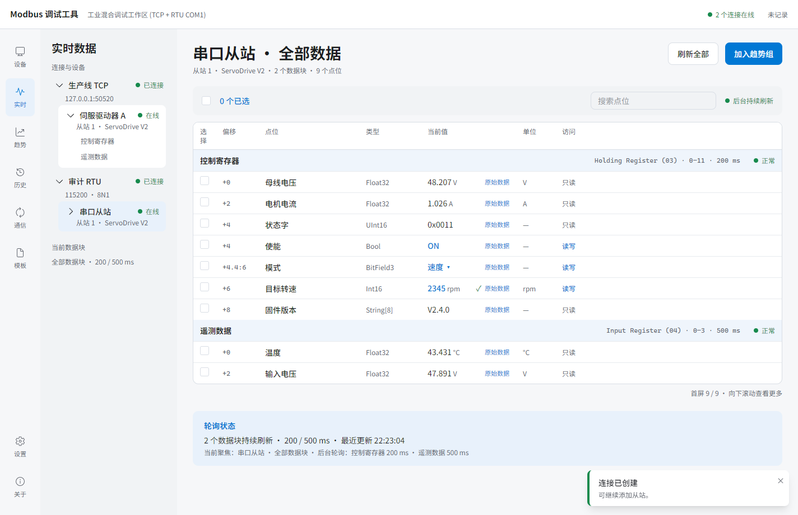

# v0.11.4 发布验收记录

- 日期：2026-10-20（Asia/Shanghai）。
- 范围：用户明确要求提交、推送并发布；版本唯一来源为 `package.json` 的 0.11.4。
- 起点：`ba8df36` 之后的本轮修复；细化标准、故障复现与已完成的增量验证见[审核修复记录](../acceptance/audit-fixes-2026-10-20.md)。
- 应用功能源码提交：[`2525ebc`](https://github.com/loogg/modbus-debugger/commit/2525ebc9c4782619964ded9c343753ed76c80c36)，已正常推送到 `master`；发布标签包含后续测试清理等待修正及验收资料。
- 发布标签：[`v0.11.4`](https://github.com/loogg/modbus-debugger/tree/v0.11.4)，指向 `22e5cf6ecd86b65b50489379661a90f89c34177a`。公开结果在标签创建后独立补录，不移动标签。
- 公开结果：[GitHub Release](https://github.com/loogg/modbus-debugger/releases/tag/v0.11.4)，2026-10-20 18:01:34（Asia/Shanghai）发布；[标签构建与发布工作流](https://github.com/loogg/modbus-debugger/actions/runs/39404078205)。
- 正式条件：[当前验收清单](../acceptance.md)。本记录区分实际通过、跳过与外部服务限制。
- 平台：Windows x64；Node.js 24.13.1；Python 3.11.7 / PyModbus 3.15.0。首轮发布时串口枚举为空，RTU 用例明确跳过；用户随后提供 COM1 ↔ COM2，补验状态见文末。
- 全部运行数据、模拟器、数据库与临时产物隔离在 `out/test-temp/`。原有 `.agents/`、`skills-lock.json` 属于先前本地资料，不纳入本轮应用提交。

## 发布方案与基本标准

1. 对照现行清单运行全部适用 Unit / Integration、打包版 E2E、首次使用和百万样本容量场景；已有真实界面证据按代码影响复用，新增结果注明实际候选。
2. `npm run make -- --platform=win32 --arch=x64` 生成同版本目录、ZIP、Portable、Setup 及更新 manifest；四种形式 Smoke 均通过后才能发布。
3. 验证真实目录/ZIP、Portable、Setup 自升级与回滚；隔离测试中的未来版本不得发布或修改正式版本唯一来源。
4. 提交本轮应用修复、测试及验收资料；不提交运行数据或发布二进制。核对远端未前移、标签不存在后正常推送，不强制覆盖既有分支、标签或资产。
5. 使用现有标签工作流发布；等待 CI 构建、四产物 Smoke 与发布步骤完成，再检查 Release 版本、资产和下载有效性。

## 执行状态

| 范围 | 状态与结果 |
| --- | --- |
| 本轮缓存、写入、Bridge、隔离修复 | 增量闭环及正式源码候选复核通过，本地应用 `app.asar` SHA-256 为 `b31a09d6b071e49aca5c93b5387b4b318506aa39b4a9a2a854083c084736aa41`；云端包的格式差异核对见下文 |
| 静态检查、Unit / Integration | lint、typecheck、差异与文档链接检查通过；首轮完整 Vitest 为 49 文件、392 通过、7 RTU 用例跳过。发布后 7 项 RTU 补验均通过，合并覆盖 399 项互异用例；非单轮全量运行 |
| 完整打包版 E2E | 首轮 12 个 spec 的 59 项场景通过，1 项 RTU UI 跳过；发布后已补验该 RTU UI 及两项有串口界面分支。合并覆盖 60 项互异用例；补验范围及证据见文末 |
| 首次使用与百万样本 | 独立首次使用 1 项通过；100 万真实数值样本 1 项通过：会话打开 5,160 ms、回放 101 ms、游标及曲线重绘 244 ms、完整 CSV 导出 765 ms。剪贴板读回 28,888,904 字符，首末行及游标值正确 |
| 四种本地产物与 Smoke | `make` 成功生成目录、ZIP、Portable、Setup 及 manifest，均为 0.11.4 / x64；`smoke:release` 对四种形式的真实启动、Renderer / IPC / serialport / 历史库、Portable 中文/空格目录及重启持久化、显式数据目录、Setup 自选目录重装/卸载及数据保留全部通过 |
| 真实自升级与回滚 | 目录/ZIP、改名 Portable、Setup 从 0.11.4 到隔离测试版 0.11.5 的下载、SHA-256 校验、helper 安装、重启与数据保留通过。Setup 故障安装退出 23 后恢复至 0.11.4，通过旧 ASAR 哈希、安装登记版本及工作区/偏好/历史库/未知用户文件断言。0.11.5 仅是隔离夹具，未发布 |
| 真实 UI / 原生交互 | 本轮受影响实时页与鉴权入口已完成 Browser Review Mode + 内置浏览器真实操作；本地正式包与增量候选具有相同的应用 ASAR。另查看最终包 1440、1280、1279、1024 四档实时页截图；最窄窗口使用表格内部横向滚动。Native 设置、文件、剪贴板与安装操作均由真实打包版验证 |
| Git 提交、推送、标签 | 应用与测试验收提交已正常推送，远端 `v0.11.4` 解引用为 `22e5cf6`；原有本地技能资料未纳入提交 |
| GitHub CI 与公开 Release | [功能源码构建](https://github.com/loogg/modbus-debugger/actions/runs/39402853215)、[发布提交构建](https://github.com/loogg/modbus-debugger/actions/runs/39404061024)、[标签构建与发布](https://github.com/loogg/modbus-debugger/actions/runs/39404078205)均成功。公开版本为最新正式版，非 draft / prerelease；ZIP、Portable、Setup 与 manifest 均完整下载，大小与 GitHub SHA-256 一致，ZIP 内 85 个文件与清单一致 |

当前结论：v0.11.4 已公开发布，全部适用发布检查、线上附件核验和 COM1 ↔ COM2 虚拟串口补验通过。物理 RS485 与现场设备未验证；GitHub 匿名 API 限流的实测边界见下文。

发布 E2E 补充说明：Raw Inspector 校验等待 Main 快照与 Renderer 当前样本一致，保留两寄存器、Float32 与完整字节断言；串口枚举为空时验证空白默认值、手动输入及取消，有可用端口时仍执行原自动预填与选项关闭断言。没有将测试条件修正计为真实串口验证，也没有降低设备确认值标准。

连续自升级验收补充：正常 Setup 升级成功后，卸载清理短暂晚于启动进程退出，紧接的回滚测试被既有安装隔离保护拦截。测试工具现有界等待安装登记与程序文件清理完成，保留未知用户文件断言；按正常升级 → 完整卸载 → 故障回滚 → 完整卸载连续复验通过。`node --check tools/smoke-self-update.mjs` 通过；该工具不进入应用 bundle，没有改动已验收的程序代码。

## 证据与覆盖边界

- 本地命令日志：`out/test-temp/release-0.11.4/` 下的 `make.log`、`vitest.log`、`e2e-full.log`、`e2e-retest.log`、`e2e-empty.log`、`e2e-capacity.log`、`smoke-release.log`。发布 E2E 使用仓库既有、与 Electron Chromium 130 匹配的本地 ChromeDriver，临时配置与数据均位于隔离目录。
- 百万样本指标与截图：`out/audit/capacity-1m-smoke.json`、`capacity-1m-history.png`、`capacity-1m-replay.png`；四档页面与弹层截图：`out/audit/screenshots/`、`out/audit/figma-current/`。这些为可重建的本地证据，不提交运行数据。
- 自升级命令日志：同一发布日志目录中的 `self-update-zip-portable.log`、`self-update-setup-final.log`、`self-update-rollback-final.log`；结果 JSON 为 `out/audit/self-update-{zip,portable,setup,setup-rollback}-result.json`，截图在 `out/audit/self-update-shots/`。仅 GitHub 元数据与包下载 HTTP 响应定向到隔离夹具，实际下载文件、校验、安装器、helper、备份、重启、数据库和注册表验证均为真实运行。
- [v0.11.1 的 30 屏 Figma 记录](figma-visual-audit-v0.11.1.md)仅保留为设计历史。本版受影响界面已重新真实审查，全 E2E 覆盖当前业务入口；不将历史图片冒充本版重新逐屏审查。
- 首轮发布时没有可用串口，7 项需串口的集成测试与 1 项 Native RTU UI 当时跳过。用户提供 COM1 ↔ COM2 后已完成本版 Windows RTU 字节链路补验，见文末；物理 RS485 与现场设备仍未验证。TCP 独立 PyModbus 互操作已通过。

## 线上交付核验

四个公开附件已实际下载，以下大小与 SHA-256 同时匹配 GitHub Release API 和本地下载文件。

| 附件（统一前缀 `modbus-debugger-0.11.4-win-x64`） | bytes | SHA-256 |
| --- | ---: | --- |
| `.zip` | 126174007 | `c34d14aa21e1c399c281ca88a656aacc7395cc84d32751b0cad37a99190f10ad` |
| `-Portable.exe` | 125941216 | `00a2594464554d7a7c1e550c5fc77cfd56d3af8fca76d8185e4ef78e7b8443a9` |
| `-Setup.exe` | 126255737 | `f3479a7ee6304dc391998796019be2d85414231d2c3b234b86ca2a46df872246` |
| `-manifest.json` | 11933 | `78f80a377c3e1633b2f6c9517f5f23ca607a5de643807ef0b03209e433183d51` |

云端 ZIP 的 `app.asar` 为 `6a625abbd610004bb8926dbf664e21a24d0ddd7c54520028f8f7cd4ca173f6e7`，与本地容器哈希不同，已逐文件核对来源：ASAR 共 251 个文件，250 个逐字节相同，唯一不同的入口 HTML 仅多了回车字符，去除 CR 后逐字节一致；Main、Preload、Renderer JS 与依赖均相同。外置更新 helper 仅换行不同；两个 EXE 除自身 ASAR header SHA-256 的 64 字符完整性资源外逐字节一致，且各自嵌入值均匹配对应 ASAR header。程序逻辑与已验收候选一致，容器格式差异有明确来源。

实际下载的 ZIP 解压后，其 85 个程序文件哈希与公开 manifest 一致；启动、0.11.4 版本与 IPC 均通过。发布后本地候选直接查询正式 GitHub API 成功返回 0.11.4；随后下载版查询遇到真实匿名 API 403 限流（剩余配额为 0），已核对界面显示实际原因、等待结束且“检查更新”可重试。公开发布页和附件下载可用。

原始证据位于 `out/test-temp/release-0.11.4/`：`published-release.json`、`published-verification.json`、`published-content-comparison.json`、`live-update-query.json` / `.log` / `.png`、`public-api-headers.txt`，以及 `published/` 下载文件。标签工作流在公开 GitHub 保留构建与 Smoke 日志；这些本地副本可清理和重建。

## 发布后 RTU 补验（2026-10-20）

用户提供并授权使用虚拟串口 COM1、COM2。当前 Node serialport 与 Python 均枚举到 ELTIMA COM1→COM2、COM2→COM1。客户端使用 COM1，独立 PyModbus 从站使用 COM2，两端为 115200 / 8N1。

基本标准与执行顺序：

1. 串行运行此前跳过的 7 项独立 RTU 线级集成用例，覆盖八功能码和尺寸边界、多 Unit / 地址隔离、CRC 故障后恢复、延迟、写异常、丢失写响应后的回读、最新寄存器 RMW / Enum / String 和动态值。
2. 使用实际下载的 0.11.4 ZIP 包运行定向 Native E2E，从可见 UI 创建 COM1 连接与从站、写入 2345、核对回读和 TCP 从站隔离；补验有串口时的枚举、默认值与选项关闭。保存并查看实际 UI 截图与 RTU 事务。
3. 全部测试使用隔离目录，集成与 Native 串行执行，避免争用端口；结束后关闭本轮模拟器及应用，确认端口可重新打开，保留日常配置。
4. 当前仅补充测试和证据，复用已发布程序与有效发布检查；有产品问题时修复并按影响范围复验。

结果：7 项 RTU 线级集成、3 项 Native 定向 UI 均通过，无 RTU 跳过或失败。Native 增加明确的 FC03 readback 成功断言、TCP 对端已获得确认值的前置断言及事务证据；该 RTU 用例在最终测试代码上再次通过。相关 lint / typecheck、文档链接与差异检查通过。

| 对象 | 实际结果 |
| --- | --- |
| 正式产物 | 实际下载的 0.11.4 ZIP；ASAR SHA-256 为 `6a625abbd610004bb8926dbf664e21a24d0ddd7c54520028f8f7cd4ca173f6e7`，与线上已核验产物一致，应用代码未修改 |
| 八功能码及恢复 | FC01/02/03/04/05/06/15/16、最大数量、地址及 Unit 隔离、CRC 错误后下一帧恢复、延迟、设备拒绝、写应答丢失后回读、最新寄存器 RMW / Enum / String 与动态值全部通过 |
| Native 写入与隔离 | UI 新建 COM1 连接及 Unit 1 从站，输入 2345；RTU 设备确认值为 2345，TCP 对端有确认值且仍为 1500。RTU FC06 请求/应答为 `010600060929ae45`，随后 FC03 读取数量 12 的回读成功，目标寄存器为 `0x0929` |
| 串口界面与视觉 | 实际枚举 COM1、COM2，默认 COM1；打开下拉、选择后关闭、自定义波特率与取消通过。已查看真实 Native 截图：串口在线、设备确认值 2345、写入成功标记及工程列可读；两条连接均在线 |
| 隔离与释放 | 集成与 Native 串行运行，夹具副本和数据库位于 `out/test-temp/`。日常偏好不变；测试结束后 COM1、COM2 均成功重新打开并关闭，端口已释放 |

复现命令：设置 `$env:MODBUS_RTU_MASTER_PORT='COM1'` 与 `$env:MODBUS_RTU_SLAVE_PORT='COM2'`，执行 `npm test -- tests/integration/simulator-wire.test.ts -t 'RTU independent' --reporter=verbose`。日志中的 8 项 skipped 是本次名称筛选排除的 TCP 用例，7 项 RTU 全部实际执行。Native 使用现有 WDIO / Electron Service 与匹配 Chromium 130 的本地 ChromeDriver，临时配置指向公开 ZIP 解压目录，筛选 RTU、串口枚举和默认值场景。

本地证据：`out/test-temp/release-0.11.4/rtu-wire.log`、`rtu-e2e.log`、`rtu-e2e-final.log`、`rtu-ports.json`；实际帧与确认值保存于 `out/audit/rtu/ui-write-readback.json`。以下关键截图保留在 Git，显示串口从站经回读确认 2345，TCP 对端同时在线。

本次验证覆盖虚拟串口驱动与正式 RTU 字节链路；物理 RS485 接线、电气噪声、收发器方向及具体厂商设备行为仍需现场验证。
